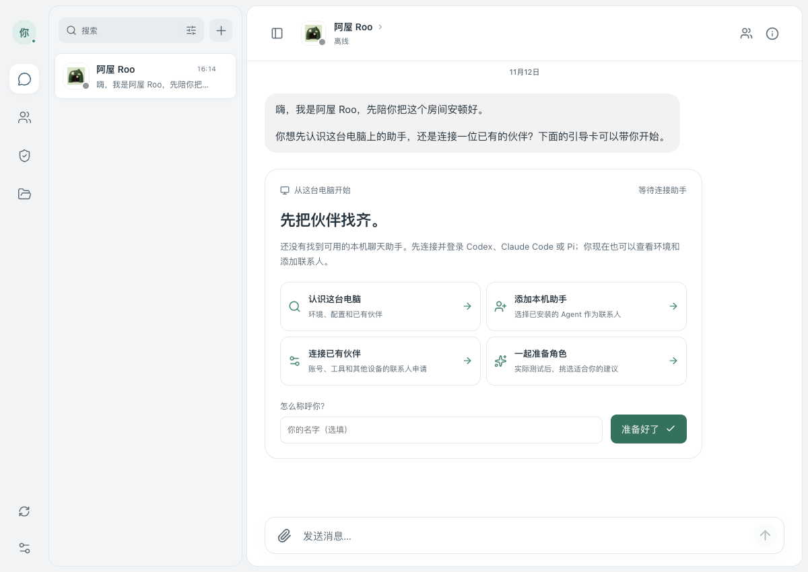
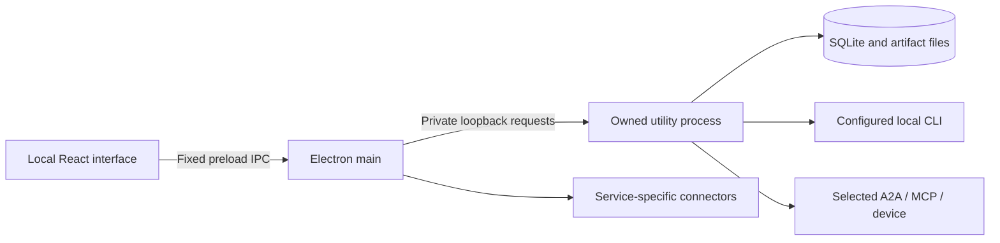

<p align="center"></p>
<h1 align="center">AgentRoom</h1>
<p align="center">Your agents, under one roof.</p>
<p align="center"><a href="https://github.com/getyak/agentroom/releases">Download for Mac</a> · <a href="README.zh-CN.md">简体中文</a> · <a href="docs/README.md">Documentation</a></p>

AgentRoom is a local-first Mac app for conversations with your own AI agents. Meet **阿屋 Roo**, find the assistants already configured on your computer, give them distinct roles, and bring them into a direct conversation or group. Review requests and keep the resulting work beside the conversation.

**The project now lives at [getyak/agentroom](https://github.com/getyak/agentroom).** New issues, pull requests and releases belong here. AgentStudio history and notices are retained; internal package and storage identifiers remain compatible.

<p align="center"></p>

## Start with Roo

Roo uses the AgentRoom icon and an eligible local Codex, Claude Code or Pi backend. It explains its choice and opens the existing setup flows. Discovering a configuration does not verify a model call; opening the app does not invoke a model. With no eligible assistant, the guide still helps you connect one.

1. Download the Apple Silicon archive from [Releases](https://github.com/getyak/agentroom/releases), unzip it and move the app into Applications.
2. Open Roo's first conversation. Inspect this computer, add a local assistant or connect an existing account/device.
3. Send a message, or create a group and choose which partners to include. Adopt role suggestions after reviewing them.

The current release is **0.2.0-alpha.1**, for Apple Silicon Macs. It is ad-hoc signed and **not Apple notarized**. Installation details, checksums and exact source provenance are in the [release notes](docs/releases/0.2.0-alpha.1.md). Existing workspaces keep their data; Settings → 测试与引导 reopens the guide or creates an isolated test profile.

## Work with your agents

| Area | What is available |
| --- | --- |
| Contacts | Local assistant discovery, explicit adoption, custom roles, model/thinking settings and stable identities. Human contacts currently keep local notes. |
| Conversations | Direct/group chat, streaming replies, queued follow-ups, mentions, reactions and optional silence. Drafts and accepted execution settings survive navigation and restart. |
| Decisions | Source-attributed requests with exact targets and payloads. Routine addressed contact chat uses your Send action; task forwarding, MCP calls and creation proposals retain their own decisions. |
| Shared work | Versioned documents/websites, contributor proposals, scoped permissions, local preview and explicit acceptance. A local preview is separate from publication. |
| Your devices | Enroll owned server agents or explicitly share selected local CLI contacts between Macs over Tailscale. Each device retains its own accounts and database. |
| Agent goals | Per-contact goals and optional local scheduling, off by default. The Mac and app must be available for new local work. |

Codex, Claude Code and Pi have execution adapters. Gemini and OpenCode are discovery/install hints. Grok Bot, Muse, ChatGPT Dots and Cue have service-specific connection flows with different capabilities and evidence; see [connections](docs/personal/connection-design.md) and [connector details](docs/connectors.md).

## How it runs



The desktop owns one personal workspace and its utility process. It needs no Matrix, Go, PostgreSQL or Synapse for normal use. Closing the window keeps the app's background work available; quitting stops its owned utility. Queued work can resume, while uncertain execution remains visible for reconciliation.

Conversations and local artifact files stay on your Mac. Selected context goes to the model provider or remote service you use. “Local-first” describes ownership and storage; it does not mean that every model runs offline.

## Run from source

Use the pinned pnpm version in `package.json` and Node **22.13+**:

```sh
git clone https://github.com/getyak/agentroom.git
cd agentroom
pnpm install --frozen-lockfile
pnpm --filter @agentstudio/core build
pnpm dev:desktop
```

The first launch opens a real local workspace. To test with separate app data, use `pnpm dev:desktop:test`; CLI logins and quotas remain shared. A model conversation needs an installed, signed-in supported CLI. See [the desktop guide](apps/desktop/README.md) for builds, packaging and configuration.

| Directory | Responsibility |
| --- | --- |
| `apps/desktop` | Native lifecycle, trusted IPC, owned utility, service connectors and preview windows |
| `apps/personal` | Shared Messenger UI and the local workspace engine |
| `packages/brand` | Product/service assets with provenance |
| `packages/core`, `server`, `apps/mobile` | Retained Matrix/client route; see [legacy setup](docs/legacy-matrix.md) |
| `dev`, `e2e` | Development tools, isolated acceptance and retained Matrix end-to-end tests |

## Read the design

| Document | What it answers |
| --- | --- |
| [Architecture](docs/architecture.md) | Processes, module ownership, data and trust paths |
| [Detailed design](docs/detailed-design.md) | Identities, accepted runs, decisions, recovery and shared works |
| [Interaction and visual design](docs/design.md) | Navigation, first use, portraits, states and accessibility |
| [Roadmap](docs/roadmap.md) | What is shipped and what remains proposed |
| [Implementation sequence](docs/plans/architecture-evolution.md) | Reviewable future changes and their acceptance criteria |
| [Repository migration](docs/repository.md) | Canonical remote, existing checkouts and compatibility identifiers |

The architecture/design guides are currently in Chinese. [API contracts](docs/api.md), [client test IDs](docs/clients.md) and module references retain their existing languages.

## Contribute

Open issues and PRs against **`getyak/agentroom:main`**. Start with [CONTRIBUTING.md](CONTRIBUTING.md) and [AGENTS.md](AGENTS.md). CI checks types, unit tests and the personal browser journeys; native release acceptance is a separate step. The optional Matrix route uses `AGENTSTUDIO_WORKSPACE=matrix` and has its own setup and tests.

## Privacy and use

Use AgentRoom with your own accounts and trusted devices. The existing personal learning/research disclaimer excludes commercial use and operating a service for others; read the full [disclaimer](#disclaimer) before connecting services. Generic Bearer credentials use a protected local AES-GCM file vault; service-specific sign-ins have their own storage. A separate CLI working directory and prompt rules do not sandbox every preconfigured plugin.

AgentRoom is alpha. Human-to-human delivery, shared desktop database synchronization, general friend grants, automatic updates and Apple-notarized distribution are not shipped features. Current limits are listed with the [architecture](docs/architecture.md#当前范围与演进) and [security policy](SECURITY.md).

## Disclaimer

**⚖️ FOR PERSONAL LEARNING AND RESEARCH USE ONLY.** Read this before you use AgentRoom, and in particular its connectors for Grok Bot, Muse, ChatGPT Dots and Cue.

- **Personal use only.** Use AgentRoom on your own Mac, with your own accounts, to reach your own agents. Explicit, bounded guest-room invitations use restricted local agents; they do not authorize third-party personal connectors for other people's use. Don't use it commercially, as a general hosted service, to automate at scale, or with accounts that aren't yours.
- **Local app and storage.** There is no hosted AgentRoom server. Selected context is sent to your configured model provider or an approved remote agent/tool. Legacy sign-ins use Electron safeStorage; personal Bearer credentials use the documented local file vault, not Keychain.
- **Not affiliated.** AgentRoom isn't affiliated with or endorsed by xAI / SpaceX AI, Cursor (Anysphere), Meta, OpenAI, Manus, Nous Research or OpenClaw. Their names and logos are trademarks of their owners and appear only to say which service a connector reaches.
- **Unofficial connectors.** Except for Cue's messaging (Manus's documented API), the connectors work the way each service's own app or website does. That may be against a service's terms, and it can stop working at any time.
- **Your responsibility.** You are responsible for following each service's terms and the laws where you live. If you aren't sure, don't connect it.
- **Use at your own risk.** AgentRoom comes "as is", without warranty of any kind (see the Apache-2.0 license). The authors aren't liable for any loss, account restriction or other consequence of using it.

Details per service: [docs/connectors.md](docs/connectors.md).

## License

[Apache-2.0](LICENSE). Original attribution is retained in [NOTICES.md](NOTICES.md). Service names and brand images belong to their owners; see [asset sources](packages/brand/README.md).

Merged AgentStudio features are tracked in the [migration audit](docs/migrations/agentstudio-merged-features.md), including reviewed guest group invitations, shared notes/games, Roo project setup and automatic member portraits.
