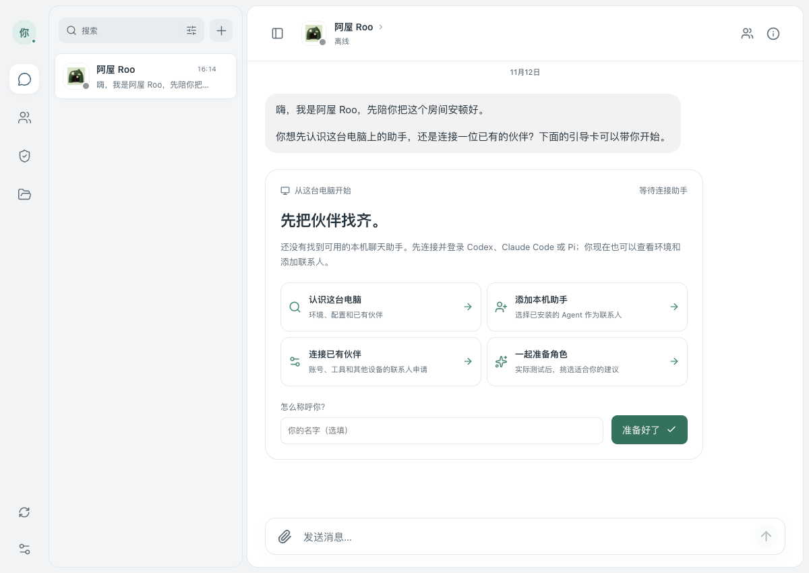
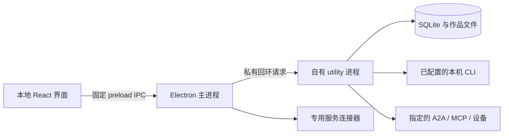

<p align="center"></p>
<h1 align="center">AgentRoom</h1>
<p align="center">把你的 Agent，带进同一个房间。</p>
<p align="center"><a href="https://github.com/getyak/agentroom/releases">下载 Mac 版</a> · <a href="README.md">English</a> · <a href="docs/README.md">文档</a></p>

AgentRoom 是一款以本机资料为中心的 Mac 应用。先认识向导 **阿屋 Roo**，找到电脑上已经配置的助手，为它们设置不同角色，再私聊或拉进群里一起做事。需要你决定的请求和做出的作品，都能回到对应对话里查看。

**项目主仓库已迁至 [getyak/agentroom](https://github.com/getyak/agentroom)。** 后续 issue、PR 和发布都在这里进行。AgentStudio 的提交历史与原有声明保留，内部包名和资料路径继续兼容。

<p align="center"></p>

## 从阿屋开始

阿屋使用 AgentRoom 图标，从本机符合条件的 Codex、Claude Code 或 Pi 中选择后端，说明选择依据，再带你完成接入。读到登录配置不代表模型已经运行成功；打开应用不会调用模型。暂时没有可用助手，也能先使用引导卡。

1. 从 [Releases](https://github.com/getyak/agentroom/releases) 下载 Apple Silicon 压缩包，解压后将应用放进 Applications。
2. 打开阿屋的首段会话，查看这台电脑，添加本机助手，或连接已有账号和设备。
3. 发一条消息开始聊天；需要多位伙伴时再建群。角色建议经你查看并采用后，才会成为联系人。

当前版本为 **0.2.0-alpha.1**，支持 Apple Silicon Mac，使用 ad-hoc 签名，**尚未经过 Apple 公证**。安装方式、校验和与对应源码见[发布说明](docs/releases/0.2.0-alpha.1.md)。已有工作区保留原资料；「设置 → 测试与引导」可以重新找阿屋，也可以进入独立测试资料。

## 和伙伴一起做事

| 场景 | 现在可以做什么 |
| --- | --- |
| 联系人 | 发现并明确添加本机助手，设置角色及模型，保留稳定身份。人的联系人目前用于本机记录。 |
| 对话 | 私聊、群聊、流式回复和连续提问；可提及指定成员、用表情回应，也允许按规则保持安静。草稿和已接受的执行配置会保留。 |
| 决定 | 查看请求来自哪位伙伴、要发到哪里、具体做什么。普通联系人聊天由发送动作发起；任务转交、MCP 调用和创作方案仍各有审批。 |
| 共同作品 | 讨论分工，批准方案，按权限共同修改文档或网站；保留版本、在本机预览，再明确接受。本机预览与对外发布分开记录。 |
| 自己的设备 | 加入服务器上的 Agent，或通过 Tailscale 在两台 Mac 间共享选定的本机 CLI 联系人。各设备保留自己的账号和数据库。 |
| Agent 目标 | 为联系人设置目标，按需启用本机调度，默认关闭。派发新的本机工作需要 Mac 和应用可用。 |

Codex、Claude Code 和 Pi 已有执行适配器；Gemini、OpenCode 当前提供发现与安装提示。Grok Bot、Muse、ChatGPT Dots、Cue 使用各自的接入流程，能力和验收范围不同，详见[连接说明](docs/personal/connection-design.md)与[连接器文档](docs/connectors.md)。

## 应用怎样运行



默认桌面模式自带个人工作区后台，无需启动 Matrix、Go、PostgreSQL 或 Synapse。关闭窗口后，应用自己的后台继续工作；退出应用会停止它拥有的 utility。下次启动可以恢复队列，结果不确定的运行保留为待核查。

聊天和作品文件由这台 Mac 保存。选定上下文仍会交给你使用的模型提供商或远端服务。「本机优先」描述资料的归属与存储方式，并不代表所有模型都离线运行。

## 从源码运行

使用 `package.json` 锁定的 pnpm 版本和 **Node 22.13+**：

```sh
git clone https://github.com/getyak/agentroom.git
cd agentroom
pnpm install --frozen-lockfile
pnpm --filter @agentstudio/core build
pnpm dev:desktop
```

首次启动会打开真实的本机工作区。需要隔离应用资料时用 `pnpm dev:desktop:test`，本机 CLI 的登录与额度仍会沿用。真实模型对话需要自行安装并登录受支持的 CLI。构建、打包和配置方式见[桌面说明](apps/desktop/README.md)。

| 目录 | 职责 |
| --- | --- |
| `apps/desktop` | 原生生命周期、可信 IPC、自有 utility、专用连接器和预览窗口 |
| `apps/personal` | 共享聊天界面与个人工作区引擎 |
| `packages/brand` | 产品及服务素材，附来源说明 |
| `packages/core`、`server`、`apps/mobile` | 保留的 Matrix 与客户端路线，见[兼容入口](docs/legacy-matrix.md) |
| `dev`、`e2e` | 开发工具、隔离验收，以及原 Matrix 端到端测试 |

## 了解设计

| 文档 | 内容 |
| --- | --- |
| [架构](docs/architecture.md) | 进程、模块归属、数据存储和信任关系 |
| [详细设计](docs/detailed-design.md) | 身份、运行快照、审批、恢复和共同作品 |
| [交互与视觉](docs/design.md) | 导航、首次使用、头像、状态和无障碍 |
| [路线图](docs/roadmap.md) | 已发布能力与后续提议 |
| [实施顺序](docs/plans/architecture-evolution.md) | 后续改造的交付范围和验收标准 |
| [仓库迁移](docs/repository.md) | 新主仓库、已有工作区及兼容标识 |

架构与设计文档目前以中文为主；[API](docs/api.md)、[测试标识](docs/clients.md)和模块参考保留现有语言。

## 参与开发

新的 issue 和 PR 发到 **`getyak/agentroom:main`**。先读 [CONTRIBUTING.md](CONTRIBUTING.md) 和 [AGENTS.md](AGENTS.md)。CI 检查类型、单元测试和完整个人模式浏览器流程；原生发布包另行验收。可选的 Matrix 模式通过 `AGENTSTUDIO_WORKSPACE=matrix` 进入，有自己的环境与测试要求。

## 资料与使用范围

请使用自己的账号和可信设备。项目原有声明将用途限定为个人学习与研究，不用于商业用途或为他人运行服务；连接第三方服务前请阅读下方[免责声明](#免责声明)。通用 Bearer 使用受保护的本机 AES-GCM 文件 vault；专用服务登录各有存储方式。CLI 的独立工作目录与提示词不能限制所有预配置插件的权限。

当前 Alpha 尚未提供人与人的远端投递、桌面数据库同步或通用好友授权。自动更新和 Apple 公证分发也还未交付。范围与后续设计见[架构](docs/architecture.md#当前范围与演进)和[安全说明](SECURITY.md)。

## 免责声明

**⚖️ 本项目仅供个人学习和研究使用。** 使用 AgentRoom 之前，尤其是使用 Grok Bot、Muse、ChatGPT Dots 和 Cue 的连接器之前，请先阅读以下内容。

- **仅限个人使用：** 请在你自己的 Mac 上、用你自己的账号连接你自己的 agent。请勿用于商业用途，不要用来为他人提供服务、批量自动化，或使用不属于你的账号。
- **本机应用与存储：** 没有托管的 AgentRoom 服务器。选定上下文会发送给本人配置的模型提供商或已批准的远端服务；旧登录凭据使用 Electron safeStorage，个人 Bearer 使用明确说明的文件 vault，而不是 Keychain。
- **与相关服务无关联：** 本项目与 xAI / SpaceX AI、Cursor（Anysphere）、Meta、OpenAI、Manus、Nous Research、OpenClaw 均无关联，也未获得其认可。相关名称和图标归各自所有者，仅用于标明连接的是哪个服务。
- **非官方接入：** 除 Cue 的收发消息使用 Manus 公开的官方 API 外，其余连接器都模仿对方 App 或网页的工作方式，可能违反对方的服务条款，也可能随时失效。
- **责任自负：** 你需要自行遵守各服务的条款和所在地的法律法规。如不确定，请不要连接。
- **风险自担：** 本项目按"原样"提供，不提供任何担保（见 Apache-2.0 许可证）。作者不对使用本项目造成的任何损失、账号受限或其他后果负责。

各服务的具体情况见 [docs/connectors.md](docs/connectors.md)（英文）。

## 许可证

[Apache-2.0](LICENSE)。原有归属声明保留在 [NOTICES.md](NOTICES.md)。第三方名称与品牌素材归各自所有者，见[素材来源](packages/brand/README.md)。
