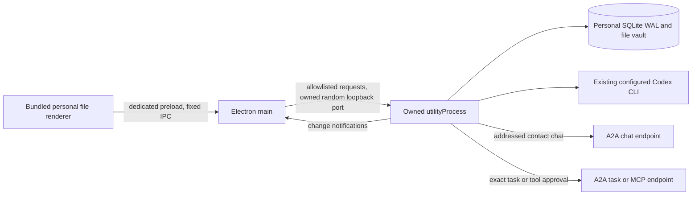
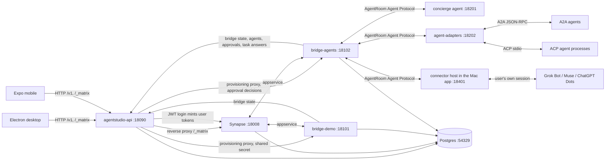

> 历史快照：2026-11-12，来源提交 `fabf253`。保留原文用于追溯；其中的状态、估期和未勾选事项不代表当前交付。当前入口见[文档索引](README.md)、[架构](architecture.md)与[路线图](roadmap.md)。

# AgentRoom architecture

## AgentRoom compatibility and test profiles

AgentRoom is the display brand; existing `agentstudio` package, wire, storage and bundle identifiers remain compatible. Native main selects a separate userData/sessionData/personal directory for test mode, with opaque profile rotation for reset. The worker freezes new writes and scheduling before checking idle state, and main requires confirmed utility exit before relaunch. No HTTP reset endpoint exists. See [test profiles and onboarding](personal/testing.md).

## Default macOS personal workspace

The existing Electron app opens the personal workspace by default. It retains its native `hiddenInset` window, traffic lights and Mac menus. The homepage is a personal messenger with contacts, direct messages, groups and unified approvals. Each conversation owns messages, ordered per-agent runs, versioned decisions and immutable Markdown artifacts. The default path needs no Matrix, Go, Postgres or bridge. See [setup and boundaries](personal/README.md), [desktop lifecycle](../apps/desktop/README.md) and [the decision record](personal/design.md).



| Component | Ownership and boundary |
| --- | --- |
| Renderer | `out/renderer/personal/index.html`, separate `out/preload/personal.js`, `window.agentStudioPersonal`; production CSP has `connect-src 'none'`, so API HTTP stays outside the renderer. |
| Main | Accepts fixed JSON routes only from its trusted top-level personal document; native save dialog writes artifact bytes and verifies their hash. It rejects legacy session/connector IPC in personal mode. |
| Utility | `out/main/personal/worker.mjs` plus the copied backend ESM modules listed in `apps/desktop/electron.vite.config.ts`; Electron-bundled Node/SQLite, one workspace, port 0, owner/workspace handshake; one bounded registry runs up to three independent invocations with per-conversation/session lanes. It never attaches to an existing port 18740 service. |
| Data | `app.getPath('userData')/personal`, normally `~/Library/Application Support/AgentStudio/personal`; `AGENTSTUDIO_PERSONAL_DATA_DIR` selects an explicit directory. A separate SQLite lock rejects a second worker. No automatic import from Matrix, `.local/personal` or browser accounts. |

Closing the Mac window hides it while the utility continues. Quitting closes only the owned utility; recovery resumes queued work but preserves uncertain remote effects for reconciliation. One unexpected crash restart is bounded; requests are not automatically resubmitted. Concurrent explicit restarts coalesce, and a later shutdown supersedes an older restart. Forced PID termination requires the same captured and current utility identity. Source provenance records Git HEAD with `-dirty` when applicable.

The shared `apps/personal` UI and backend can also run as an auxiliary web service on 18740 (Vite development UI 18741), with separate `.local/personal` data. This is not the native default. Personal Bearer credentials use an AES-256-GCM file vault, not Keychain; prompts and CLI read-only shell policy do not enforce all configured plugin permissions. Account and packaging acceptance remain separately scoped in the [macOS ledger](personal/macos-acceptance.md).

## Independent coauthored artifacts

The personal utility owns `CreationService`, `CollaborationRuntime` and `ArtifactStore`. Discussion tools create one version-bound shared proposal per owner message; an owner decision creates a frozen capability grant and a bounded step DAG. Codex receives a private stdio MCP server and Pi an explicit trusted extension. Both call the same per-run authenticated loopback broker, whose handler recovers identity from accepted run records. Agent roles never supply their own authority.

`PersonalWorker` remains the only model execution lane. Delegation queues without waiting; yielding saves a checkpoint and frees the lane. Permission waits preserve draft stages. Group membership/binding changes revoke effective capabilities; cached tool results and outgoing group replies are checked again. Work-only output is never broadcast as a normal group reply.

SQLite owns identities, grants, queue and head pointers. Files under `artifacts/aw_…/objects/sha256` and immutable revision manifests own content; `current/` is a protected Finder projection. Human edits, brief changes, conflicting writes and incomplete swaps preserve data instead of silently replacing it. Read receipts retain content hashes, with per-thread indexed status receipts; private work and permission details are excluded from group projections. Owner edit effects run outside their durable operation-reservation transaction, allowing the content store to commit its own head transaction before materialization.

The renderer opens a specific version through an opaque expiring `agentroom-artifact:` capability in a sandboxed iframe. Main also runs a serialized hidden-window page/error and narrow-layout check, then reports the verdict over the private utility channel. A website remains `waiting_preview` until that check succeeds; private intermediate heads never replace the delivered Finder tree or group version. `deliveredRevisionId` is separate from head and user acceptance. Geometry is evaluated in an isolated world; each queued check owns its cancellation scope and window. No renderer route can submit its own passing verdict. Content integrity, native preview, explicit user acceptance and publication are separate states. See [workflow and tools](personal/artifact-coauthoring.md), [API contract](api.md) and [current evidence](personal/artifact-coauthoring-acceptance-2026-11-11.md).

## Local Agent identity and staged sharing

Local discovery retains backend inventory without adding every new system contact to the address book. An explicit local adoption updates the relationship on the stable contact, reusing existing chats and model configuration. Legacy records retain their visibility. The card and quick-add UI use the existing personal worker/SQLite/fixed IPC; they do not introduce another process, listener or model call. Model defaults describe configuration; current adapters provide no quota receipt.

The confirmed longer-term direction is friends calling an Agent on its owner's computer. Same-owner multi-device identity/pairing/routing comes in phase two; real friend relationships and revocable grants with independent sessions/usage limits come in phase three. Those phases require actual authenticated transport and adapter-level delegated-use capability. The local personal workspace does not currently provide either. See the [phase-one design](superpowers/specs/2026-11-11-local-agent-cards-design.md).

## Retained Matrix architecture (v0.1)

Set `AGENTSTUDIO_WORKSPACE=matrix` to select the original renderer, preload, sessions and connectors. The remaining sections describe that path and keep its contracts intact.

AgentRoom is an open-source inbox for your chats and your AI agents. Agents show up as contacts. When an agent needs a decision, it sends an approval card. You can forward any message, with its context, to an agent and get reply drafts back.

v0.1 runs locally on macOS. Desktop (Electron) comes first, then mobile (Expo / React Native).

## Scope of v0.1

| In | Out (later) |
|---|---|
| Email-code sign-in, sessions, Matrix credentials minted per user | Google/Apple sign-in, invites |
| Synapse homeserver, federation off | Hosted multi-region, sliding sync |
| `demo` network bridge (simulated contacts, deterministic) for development and e2e | Stock mautrix bridges in e2e (they need real accounts), and dev scripts to run them (planned under `dev/bridges/`). |
| `agentstudio-agents` bridge speaking the open AgentRoom Agent Protocol, plus A2A and ACP agents through `agentstudio-agent-adapters` | OpenClaw gateway adapter |
| Desktop connectors for Grok Bot, Muse and ChatGPT Dots through the user's own signed-in session, on the Mac (`docs/connectors.md`) | Connectors that keep running while the Mac app is closed |
| Reference agent `concierge` (deterministic, used by e2e) | Hosted agents |
| Approvals (REST, versioned, idempotent) with cards in chat | Push gateway, APNs |
| Tasks: "Ask an agent" with context preview, drafts back, insert into chat | Merged chats, mutes, pins |
| Electron Mac app: inbox, chat, connect accounts, agents, approvals, tasks, ask | iMessage helper (phase 2, Mac-local) |
| Expo mobile app: same core flows. Tested on web target until Xcode is installed. | Native iOS builds |
| Playwright e2e against a locally started stack | CI |

## Processes and ports (local dev)

All processes bind to 127.0.0.1. Runtime state lives under `.local/` (git-ignored).

| Process | Port | What |
|---|---|---|
| PostgreSQL 18 (Homebrew binary, private cluster in `.local/pg`) | 54329 | databases `synapse`, `agentstudio`, `bridge_demo`, `bridge_agents` |
| Synapse (uv venv in `.local/synapse-venv`) | 18008 | homeserver, `server_name: agentstudio.local` |
| `agentstudio-api` (Go) | 18090 | REST `/v1/*`, internal `/internal/v1/*`, and a reverse proxy for `/_matrix/*` to Synapse. Clients use this single base URL. |
| `agentstudio-bridge-demo` (Go, mautrix bridgev2) | 18101 | appservice and provisioning |
| `agentstudio-bridge-agents` (Go, mautrix bridgev2) | 18102 | appservice, provisioning, agent callback endpoint `/agentstudio/v0/callback/*`, and `/agentstudio/internal/v1/approval-decisions` |
| `agentstudio-agent-concierge` (Go) | 18201 | reference agent implementing the AgentRoom Agent Protocol |
| `agentstudio-agent-adapters` (Go) | 18202 | the AgentRoom Agent Protocol in front of A2A agents (`/a2a/{target}`) and allowed ACP agents (`/acp/{agent}`) |
| `agentstudio-dev-a2a-echo` (Go, dev only) | 18203 | a tiny deterministic A2A agent for e2e |
| desktop connector host (inside the Mac app) | 18401 | the AgentRoom Agent Protocol for the Mac's connectors (`/c/{instance}`), per-instance bearer token |
| `e2e/fakes/agents.ts` (tests only) | 18410 | fake Grok Bot backend and fake Muse / Dots pages |
| mobile web (Expo export, static; or `pnpm dev:mobile`'s Expo dev server) | 18300 | e2e target for the mobile app |
| desktop renderer dev server (`pnpm dev:desktop` only) | 5173 | electron-vite / Vite dev server for the Electron renderer |



## Repository layout

```
docs/                     architecture, API, agent protocol, Matrix events (the contracts)
server/                   Go module github.com/DolphinMiner/agentstudio/server
  cmd/agentstudio-api/
  cmd/agentstudio-bridge-demo/
  cmd/agentstudio-bridge-agents/
  cmd/agentstudio-agent-concierge/
  internal/api/...        REST handlers, auth, store, matrix minting, proxy
  internal/bridges/demo/  bridgev2 NetworkConnector
  internal/bridges/agents/
  internal/agentproto/    shared Go types for the AgentRoom Agent Protocol
  internal/agenthost/     agent side of the protocol (sessions, ordered callbacks) for adapters
  internal/adapters/      a2a/ and acp/ backends, served by cmd/agentstudio-agent-adapters
  internal/concierge/
packages/core/            TypeScript, no DOM or React Native imports: API client, session, Matrix client wrapper, event schemas, inbox model, ask builder
apps/desktop/             Electron + electron-vite; personal default and retained Matrix renderers, bundled locally
  src/main/personal-host.ts  owns the personal utility, fixed HTTP forwarding and native artifact saves
  src/main/worker.mjs     utility bootstrap; build copies the backend beside it
  src/preload/personal.ts dedicated personal IPC bridge
  src/main/connectors/    on-device connectors (Grok Bot, Muse, Dots) and their protocol host
apps/personal/            shared personal UI, native adapter, Node/SQLite engine and file vault
apps/mobile/              Expo (React Native) app using @agentstudio/core
e2e/                      Playwright: desktop (Electron) and mobile (Expo web) specs; fakes/ for the connectors
dev/                      local stack: stack manager (stack.mjs), config templates
```

## Key decisions

- **License Apache-2.0.** Synapse and stock mautrix bridges are AGPL. They run unmodified as separate processes, so their license does not reach this repo. Our bridges depend only on mautrix-go, which is MPL-2.0 and applies file by file.
- **One base URL per server.** Clients only know `AGENTSTUDIO_SERVER_URL`. The API proxies `/_matrix`, so desktop, mobile and web share one origin per server.
- **Mixed state.** Message content lives in Matrix. Approval and task state lives in REST, with `version` for optimistic concurrency and `idempotency_key` for retries. Cards in chat only reference REST ids.
- **No E2EE in v0.1.** Bridges must read plaintext. This matches the bridge model; see `docs/api.md` § Security.
- **Open protocols first, the user's own session where there is none.** Agents that speak the AgentRoom Agent Protocol, A2A or ACP connect on the server (`docs/agent-protocol.md`). Grok Bot, Muse and ChatGPT Dots have no public API, so the Mac app connects them through the user's own signed-in session (`docs/connectors.md`): their sign-ins stay on the Mac, encrypted, and the services can change or object at any time.
- **Determinism for tests.** The `demo` bridge and the `concierge` agent behave deterministically, so e2e runs without real accounts.

Historical personal tasks and current direct/group chats use the same Messenger renderer. `workspace=tasks` is a compatible old URL parameter, not a separate UI. Shared conversation tools own reading, connection preferences and precise approval; history keeps its existing thread IDs and protocols.

Personal Grok approvals use the existing main-owned adapter plus an independent utility watcher (`server/provider-approvals.mjs`). Only owner-bound utility IPC registers native sources. Main owns raw provider choices and a durable response ledger; the utility projects public cards into existing Decisions, with optional original-run correlation. Waiting does not hold the model worker. Known pending approvals resume by readback; uncertain writes are retained without replay. See [connector boundaries](connectors.md#personal-grok-bot-approval-synchronization).

## Remote server execution nodes

The personal desktop can enroll several owned Tailscale servers. Each server runs an independent loopback Node/SQLite agent node behind private Tailscale Serve HTTPS, exposing only authenticated discovery and per-agent A2A. The desktop retains its single conversation database and encrypted credentials; no personal desktop endpoint or database is exposed. Enrolled nodes use messageId as a durable taskId, persisted on the desktop before dispatch, so first-receipt loss can reconcile without a new submission. Queue recovery and uncertain execution remain distinct. See [remote nodes](personal/remote-nodes.md).


Installed desktops can opt into a separate device-sharing listener on a locally assigned Tailscale IPv4 address, port 18750. It exposes selected contact metadata and authenticated A2A messages, never the personal API. Local CLI contacts execute in independent `device_request` conversations without AgentRoom creation tool sessions; other owned Agent contacts are directory-only until provider-side session isolation exists. Imported peers are not re-exported. Manifests are checked every 15 seconds, with a 60-second success lease and distinct activity, readiness and connection state. See [device setup](personal/peer-devices.md).
