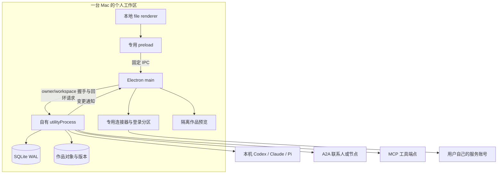
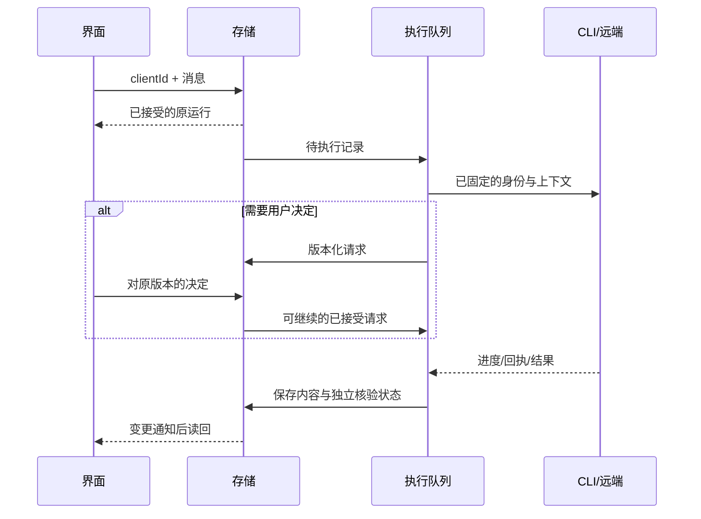

# AgentRoom 架构

状态基线：`v0.2.0-alpha.1`。本文说明当前实现；标为「后续设计」的内容进入[实施方案](plans/architecture-evolution.md)，不代表已经上线。主仓库为 [getyak/agentroom](https://github.com/getyak/agentroom)。

## 产品与运行范围

AgentRoom 围绕同一份个人工作区组织联系人、对话、运行、决定与作品。阿屋 Roo 是首次进入的向导，复用现有联系人和执行系统。工作区由一台 Mac 上的 Electron 应用持有；外部模型、个人服务和其他设备按明确连接参与。

默认模式使用 Electron、React 与 Node/SQLite。Matrix 收件箱及其 Go/PostgreSQL/Synapse 栈是可选兼容路线，详见 [Matrix 入口](legacy-matrix.md)。辅助 Web 便于开发和验收，其数据目录与桌面分开。

## 进程与信任路径

| 进程 | 拥有的内容 | 对调用方的约束 |
| --- | --- | --- |
| Renderer | React 视图、草稿、导航与当前选择 | 生产 CSP 禁止直接 API 网络请求；不暴露通用文件系统或任意 shell 能力。 |
| Preload / main | 固定 IPC、原生保存、窗口与菜单、服务登录、预览协议 | 校验可信顶层文档及请求形状；凭据不返回普通界面响应。 |
| Utility | 一个工作区的领域记录、队列、执行和恢复 | 使用自有随机回环端口；校验工作区/进程身份，不附着旧 Web 服务。 |
| CLI / 远端 | 实际模型执行或外部服务状态 | 沿用对应账号和权限。AgentRoom 的提示词不构成完整 OS 沙箱。 |

实现入口：[personal-host.ts](../apps/desktop/src/main/personal-host.ts)、[worker.mjs](../apps/desktop/src/main/worker.mjs)、[IPC 路由白名单](../apps/desktop/src/shared/personal-api.ts)、[后端组装](../apps/personal/server/index.mjs)。

## 模块归属

这些是当前代码的职责划分，并非本轮已经完成的目录重构。后续拆分应围绕可单独验证的接口进行。

| 模块 | 当前实现 | 持有的规则 |
| --- | --- | --- |
| 工作区存储 | `store.mjs`、`vault.mjs` | SQLite 独占锁、事务、幂等回执、密钥和恢复标记。 |
| 联系人与会话 | `messenger.mjs`、`unread.mjs` | 采用关系、身份、成员可见范围、消息/运行快照、阅读位置。 |
| 发现与引导 | `local-agents.mjs`、`agent-profiles.mjs`、`host-discovery.mjs`、`workspace-guide.mjs`、`agent-onboarding.mjs` | 配置投影、向导绑定、实际探测后生成角色建议、明确采用。 |
| 执行与调度 | `runtime.mjs`、`agent-scheduler.mjs` | 接受后的执行身份、并发通道、流式正文、停止、核查和可选定时触发。 |
| 连接与决定 | `integrations.mjs`、`native-services.mjs`、`provider-approvals.mjs`，以及 runtime 的远端路径 | 连接身份、精确审批、原服务回执和未知写入保护。 |
| 共同作品 | `creation-service.mjs`、`collaboration-runtime.mjs`、`artifact-store.mjs`、`artifact-tools.mjs`、`tool-sessions.mjs` | 方案、授权、依赖步骤、不可变版本、投影与预览状态。 |
| 设备与节点 | `remote-nodes.mjs`、`desktop-sharing.mjs`、`device-network.mjs`、`agent-node.mjs` | 显式开放的目录、稳定节点身份、每请求记录与结果核查。 |

上述文件均位于 `apps/personal/server`。固定调用接口和对象约束见[详细设计](detailed-design.md)与 [API 契约](api.md)。UI 由 `apps/personal/src` 共享，桌面和辅助 Web 的宿主适配各自保留。

## 数据所有权

| 数据 | 权威位置 | 重要区别 |
| --- | --- | --- |
| 联系人、会话、运行、决定、设置 | `personal.sqlite` 的 `documents` | `kind/id` 标识领域对象；`idempotency` 单独保存请求指纹与回执。 |
| 工作区进程锁 | `worker-lock.sqlite` | 同一资料目录拒绝第二个 worker；不以端口是否可用判断所有权。 |
| Bearer 凭据 | 本机 AES-256-GCM 文件 vault | 密钥和密文一起受文件权限保护；不是 Keychain，也不隔离同一 OS 用户的进程。 |
| 共同作品内容 | `artifacts/aw_…/objects/sha256`、版本清单 | SQLite 维护身份、授权和版本指针；内容对象不可变。 |
| Finder 可见文件 | 作品 `current/` 投影 | 便于用户访问；本地修改和不完整交换需要保护，不能直接视为最新可信版本。 |
| 原生服务登录 | main 管理的专用存储/Chromium 分区 | 与通用 Bearer vault 分开；不同服务的实际实现见连接器文档。 |
| 草稿与视图偏好 | 当前 profile 的本地界面存储 | 与服务端接受的请求区分，避免重试覆盖后来输入。 |

正常桌面资料保持 `~/Library/Application Support/AgentStudio/personal`。`AGENTROOM_USER_DATA_DIR` / `AGENTSTUDIO_USER_DATA_DIR` 可覆盖 profile；`AGENTROOM_PERSONAL_DATA_DIR` / 旧覆盖名可明确指定工作区。测试 profile 分开保存应用资料，CLI 登录与额度仍可能共用。兼容标识见[仓库迁移](repository.md)。

## 从发送到结果

1. 界面保留草稿并带 `clientId` 提交；宿主只接受白名单路由。
2. 后端在接受时固定输入、执行配置和联系人身份；幂等键相同但正文变化会冲突。
3. `PersonalWorker` 选择可执行的通道。默认并发上限为 3，配置可限定为 1–8；同一对话/联系人的本机运行有顺序，共享远端端点保守串行。创作及旧任务路径可要求独占。
4. CLI 或远端产生正文、请求或结果。进度正文与权威最终结果分开；读取上下文不等于送达或外部效果完成。
5. 需要决定时保存版本化请求。用户决定不能授权已变更的端点、凭据身份或方案。
6. 返回内容、作品版本和核验状态落盘，界面通过通知读回。断线和崩溃保留不确定状态，先核查原标识。

审批不覆盖普通聊天的发送意图。已明确指定的 A2A 联系人聊天由 Send 发起；旧任务转交和 MCP 工具调用仍先产生精确预览。创作方案和来自原服务的请求各有授权与回执。完整区分见[详细设计](detailed-design.md#决定与外部作用)。

## 网络与部署入口

| 入口 | 绑定与端口 | 用途 |
| --- | --- | --- |
| 默认桌面 utility | 随机回环端口，main 拥有 | 桌面自己的个人工作区 API。 |
| 辅助 Web | 默认 API `127.0.0.1:18740`、开发 UI `18741` | 独立开发/QA 工作区；不是桌面服务。 |
| 合成浏览器验收 | `18745` 与合成远端 `18746` | 仅隔离测试。 |
| 服务器 Agent 节点 | 默认回环 `18749`，另配 Tailscale Serve HTTPS | 已授权节点的发现与 A2A；不公开桌面数据库。 |
| Mac 设备共享 | 本机实际拥有的 Tailscale IPv4，`18750` | 显式选定的联系人目录与受认证 A2A；不开放个人 API。 |
| Matrix 栈 | 独立固定端口集合 | 见 [Matrix 兼容说明](legacy-matrix.md#进程与端口)。 |

Mac-to-Mac 目录共享和服务器执行已经存在。两者都不等于桌面数据库同步、全局用户身份或完整好友关系。令牌授予对应接口的访问，不能被写成通用账号归属证明。详见[设备共享](personal/peer-devices.md)与[服务器节点](personal/remote-nodes.md)。

## 生命周期与恢复

关窗隐藏、退出、后台崩溃和机器休眠分别处理。关窗后自有 utility 可以继续；退出会关闭它。队列恢复不等于重放所有写入。`unknown`、待核查和停止未确认会阻挡相应的新执行，重启不能自动清除这些标记。

切换测试 profile 前，先冻结新增写入和调度，再核对活动运行、审批、登录及未知结果；只有确认自有 utility 已退出才安排重新打开。原资料和旧测试身份保留恢复引用。具体行为以[测试模式说明](personal/testing.md)和对应宿主测试为准。

## 当前范围与演进

`v0.2.0-alpha.1` 已发布 Apple Silicon ZIP、校验和与源码回执，签名为 ad-hoc，未做 Apple 公证。CI、合成浏览器、原生包、真实账号和物理设备分别提供证据，不能互相替代。

后续设计包括：领域接口逐步收拢、联系人申请生命周期、凭据撤销与设备授权完善、备份恢复、正式签名分发与升级。人与人的远端投递、桌面数据库同步、通用好友限额和自动更新仍是后续范围。参见[路线图](roadmap.md)及[分阶段实施方案](plans/architecture-evolution.md)。

本次文档重组不改包名、bundle ID、资料目录或数据库格式。[历史架构快照](architecture-history.md)保留原 Matrix 端口、旧决策与演进记录，当前契约以本文和代码为准。
