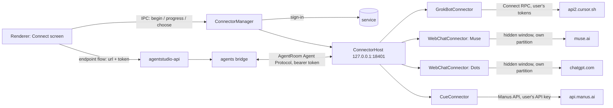

# Connectors on the Mac: Grok Bot, Muse, ChatGPT Dots, Cue

These native connector implementations serve two separate modes. `AGENTSTUDIO_WORKSPACE=matrix` retains the original Matrix bridge and storage described below. Default personal startup only attempts to restore **its own** `personal-services/manifest.json`; with no manifest, it does not initialize the connector manager. Explicitly opening the service catalog or connecting initializes it lazily. An existing personal manifest restores its own instances and registers them with the owned backend. Personal mode never reads or migrates the legacy Matrix connector store or unrelated browser profiles. See [Personal workspace native services](#personal-workspace-native-services) for that separate lifecycle and [the connection ledger](personal/connection-acceptance.md) for actual evidence; public identity metadata is not remote-account proof.

Hullo connects these agents through each user's own web session, and so does AgentRoom. None of them offers an API for third-party inboxes. AgentRoom differs in one way: the connectors run inside the Mac app, so the user's sign-ins never leave the Mac.

> **Experimental, and for personal use only.** These connectors are for reaching your own agents with your own accounts on your own Mac. AgentRoom isn't affiliated with or endorsed by xAI / SpaceX AI, Cursor (Anysphere), Meta, OpenAI or Manus. Except for Cue's messaging (Manus's documented API), they work the way each service's own app or website does, which may be against a service's terms and can break at any time; you are responsible for following each service's terms. Each connector was built from the service's public client code and checked against fakes (`e2e/fakes/agents.ts`); expect to calibrate it on first real use (see *Calibrating* below).

## How it fits (retained Matrix mode)

The architecture, storage paths, bridge callbacks, diagnostics and calibration instructions from this section through **Environment** describe the retained Matrix integration. The service-specific connector implementations are reused in personal mode with the isolation and reply rules in the final section; their original Matrix history/approval behavior does not define the personal task contract.



- **Instances.** Each connected account is an *instance*: `{id, service, token, name, data}`. Instances are stored encrypted with `safeStorage` in `userData/connectors.bin`, so the token and the service's tokens never sit on disk in plain text.
- **Host.** It listens on loopback only. Each request needs the instance's bearer token, and callbacks to the bridge are queued per instance so they stay in order.
- **Web sessions.** Muse and Dots each run in their own persistent Electron partition (`persist:agentstudio-muse`, `persist:agentstudio-dots`), so their cookies are separate from the app and from each other. Their APIs can't be called directly (see `docs/spikes/muse-dots-direct-api.md`), so the service's page does the talking.
  - **The page window never shows.** "View in Muse" / "View in ChatGPT" (Connect sheet), and cards AgentRoom can't show, open the service in the user's browser instead. `AGENTSTUDIO_CONNECTOR_SHOW=1` still shows it, for calibrating.
  - **Reconnecting.** The connector reloads the page when it shows a connection problem ("Connection error", "Reconnecting", "Offline", …) for 15 s, crashes, stops responding, fails to load, or can't be read 5 times in a row. Reloads back off (15 s, 30 s, 60 s, 2 min, then every 5 min). Meanwhile the agent shows "Reconnecting…" in the inbox and the Connect sheet, a message sent waits up to 45 s, and no "agent problem" notification goes out. Replies that arrived during the outage are still relayed.
  - **Sign-in happens in an AgentRoom window**, not the browser: these sites keep the sign-in in the browser's cookies, which other apps can't read.
  - The page runs in a hidden window. Chat drivers run in a named isolated world through Electron's in-process debugger (`Page.createIsolatedWorld` / `Runtime.evaluate`), without Node or universal cross-origin access. This avoids the `WebContents` helper's full-navigation wait when a usable page still has pending media; driver evaluation is bounded to five seconds and is never automatically replayed.
  - The user agent is plain Chrome, without the Electron token.
  - Sign-in happens in a visible window on the same partition.
  - **Muse login readiness.** The window starts hidden with a loading state in Connect. Its public login controls can become interactive before images/video finish loading. A main-frame check returns only `signedIn`/`ready` booleans, so the usable form can appear without Electron's full-navigation JavaScript wait. It returns no passwords, codes, account labels or conversations; chat drivers still run in a separate named isolated world. Initial loading is bounded to 90 seconds; cancel/close interrupts loading and pending checks, closes owned login/popups, and a cancelled request cannot reopen them. An ordinary `ERR_ABORTED` navigation after readiness does not invalidate the auth flow. See [the actual Muse investigation](personal/muse-login.md).
- **Offline behaviour.** When the Mac app is closed, these agents don't answer. When it starts again, the connectors resume.

## Grok Bot

Grok Bot (SpaceX AI, built by Cursor) has no web UI. Its desktop app, 0.78.3 (`com.anysphere.sand`), talks Connect RPC (protobuf) to Cursor's backend. The connector does the same with the user's account.

| Step | What |
|---|---|
| Sign-in | Opens `https://cursor.com/loginDeepControl?challenge=<S256(verifier)>&uuid=<uuid>&mode=login&redirectTarget=sand` in the browser. Then it polls `GET https://api2.cursor.sh/auth/poll?uuid&verifier`: 404 means pending, 200 returns `{accessToken, refreshToken}`. |
| Refresh | `POST /oauth/token {client_id: "KbZUR41cY7W6zRSdpSUJ7I7mLYBKOCmB", grant_type: "refresh_token", refresh_token}` |
| Headers | `x-cursor-client-type: sand`, `x-cursor-client-version: 0.78.3`, `x-cursor-client-os: darwin`, `x-sand-box-namespace: prod`, `x-ghost-mode: true`, `x-cursor-checksum: <obfuscated time><machine id>` |
| RPCs | `aiserver.v1.GrokBotService/` `ListGrokBotAgents`, `SendGrokBotUserMessage {agent_id, message_id, text, sent_at_ms, session_id}`, `ListGrokBotTranscriptEntries {agent_id, limit, session_id}`, `RespondGrokBotWidget {agent_id, entry_id, value, session_id}`, `DismissGrokBotWidget` |

- **Bots.** One sign-in connects every bot of the account; each becomes its own contact. Bots that are already connected are skipped. All bots of an account share one client, so a token refresh, which rotates the refresh token, happens once. `session_id` is the bot's `viewer_session_id`.
- **Replies.** The transcript is polled every 2 s after a message and every 15 s when idle. Only entries newer than the connection are relayed.
- **Entry bodies.** These are read as JSON: `{kind: "message", role, content}`, `{kind: "send-message", message: {content}}`, and `widget*` entries with `options`.
- **Widgets.** Grok Bot's cards arrive as `send-message` entries with `message: {type: "widget", widget: {prompt, options: [{label, value}]}}`. A widget becomes an approval card whose choices are the widget's options; a widget without options shows as its question. A "Dismiss" choice is added when none of the options reads as a no.

## Muse

This connector drives Meta's Muse at `muse.ai`. The page driver (`apps/desktop/src/main/connectors/drivers.ts`) uses the markup that beeper-muse (MIT) validated against live Muse:

| Part | Selector |
|---|---|
| Composer | `textarea[aria-label="Message"]` |
| Send button | `button[aria-label="Send"]` |
| Message log | `[role="log"][aria-label="Chat messages"]` |
| Messages | `[data-message-item][data-message-id][data-message-role]` |
| Busy state | `aria-busy` |

- **Replies** are relayed once their text stops changing and Muse is idle.
- A personal-service message rejected before dispatch because its connector is not ready returns a durable `failed` task. Reading or repeating that message ID returns the original failure; a new message can be sent after recovery. Transport failures after dispatch remain uncertain and are not retried.
- **Approvals.** Buttons in a reply that read as yes/no (Approve/Deny, Book/Don't book, …) become an approval card. Answering the card clicks the button on the page.
- **Other interactive cards** become a card with **Open Muse**, which shows the Muse window so the user can answer there.

## Cue

Cue (cue.im, by Manus) gives each personal agent its own email, phone number, wallet and computer. It has no web app, but Manus publishes an API that covers Cue's agents ([Agents](https://open.manus.ai/docs/v2/agents-overview)), so this connector is built on a documented API. Only the web sign-in's key creation uses an internal call; if Manus changes it, pasting a key still works.

| Step | What |
|---|---|
| Sign-in (default) | Like the Cue desktop app, in the user's browser (Google and Apple refuse sign-in in embedded windows): AgentRoom opens `manus.im/login?from=desktop&type=signIn&desktopAgents=1&nonce=…&redirectUrl=manus.im/login-success?…agentsScheme=cuedev…`. The page hands the session back on `cuedev://oauth/desktop-callback?nonce=…&token=…`. Manus only allows `cue://` (the Cue app's) and `cuedev://` (Cue's dev builds), so AgentRoom takes `cuedev://` with a tiny helper app it builds once in `userData/link-catcher` (AppleScript via `osacompile`, bundle id `org.agentstudio.link-catcher`). The helper writes each link to a file AgentRoom reads. AgentRoom can't claim the scheme itself: unpackaged Electron shares one bundle id between every copy on the Mac, so macOS could hand the link to another checkout. The Cue app doesn't need to be installed. With the session, AgentRoom calls Manus's internal `POST api.manus.im/openapi.v1.OpenapiService/CreateAPIKey {name: "AgentRoom (date)"}` once, and keeps only the API key. The user can delete that key in Manus settings to revoke AgentRoom. |
| Sign-in (API key) | "Use an API key instead": the user creates a key in Manus settings (Developers → Create API Key) and pastes it. Also offered when web sign-in fails. |
| Checking the key | `GET /v2/user.me`. The key is stored encrypted with the other connector secrets. |
| Agents | `GET /v2/agent.list` (agents created in Cue) plus `GET /v2/agent.detail?agent_id=agent-default` (the account's default IM agent, named "Cue"). Each becomes its own contact. Each agent has a **main task**, its conversation. |
| Reading | `GET /v2/task.listMessages?task_id=…&order=desc&limit=30`, every 3 s after a message and every 20 s when idle. All agents of one key share a budget of 80 requests a minute, under Manus's limit of 100. |
| Writing | `POST /v2/task.sendMessage {task_id, message: {content}}` |
| Questions | An `assistant_message` with `question_expectation.options` becomes an approval card with one choice per option, plus "Answer in Cue". The chosen option is sent back as a message. |
| Confirmations | A `status_update` with `agent_status: waiting` and a `waiting_for_event_id` (other than `messageAskUser` / `cascadeAskUser`) becomes an approval. Answered with `POST /v2/task.confirmAction`: `{accept: true/false}` when the schema has a boolean `accept`, otherwise one choice per `action` or `choice` value. Schemas AgentRoom can't fill (for example selecting ad accounts) show as a message asking the user to answer in Cue. |
| Status | `running` shows the agent as working (with its `brief`); `stopped`, `waiting` and `error` set it idle. `error_message` events show as a message. |
| Files | Attachments of an answer are added as links. |

- **Avatars.** The Manus API doesn't expose agents' avatars, so Cue agents show the Cue icon for now.
- **Answered elsewhere.** A message sent from the Cue app cancels AgentRoom's open cards for that agent.

## ChatGPT Dots

This connector drives `chatgpt.com/dots` (the "orbit" routes) in the same way. The driver understands two kinds of ChatGPT markup:

| Markup | Messages | Composer | Submit / busy |
|---|---|---|---|
| Classic | `[data-message-author-role]`, `[data-message-id]` | `#prompt-textarea` (contenteditable) | `[data-testid="send-button"]`, `[data-testid="stop-button"]` |
| New "octane" | turns marked by `[data-user-message-actions]` / `[data-assistant-message-actions]` | `textarea[name="prompt"]` | `button[data-composer-submit]` |

The authenticated Dots pages could not be inspected without an account. This is the connector most likely to need calibration.

## What comes over from each service

On first connect each connector imports the last 20 messages of the conversation as history (no notifications). After that:

| Service | Shown | Shown as a note ("Open … to see it") | Left out |
|---|---|---|---|
| Grok Bot | `message` (assistant), `send-message` `text`, `send-message` `widget` (a card), what the user typed in Grok Bot (`message` role user, `user-attachment`) | `send-message` `attachment` and `visualization`, `voice-call`, `mcp-app`, any kind AgentRoom doesn't know | `tool-call`, `notice`, `event`, `feedback` (Grok Bot's internals) |
| Cue | `assistant_message` (text and files; files come over as images/files), questions with options (a card), action confirmations (a card), `error_message`, what the user typed in the Cue app (`user_message`) | confirmations whose input AgentRoom can't fill | `status_update` (shown as working/idle), `tool_used`, `plan_update`, `explanation` |
| Muse, Dots | replies, yes/no buttons (a card), what the user typed on the page | interactive cards without yes/no buttons | message menus |

AgentRoom's own messages appear in each service's transcript too; connectors skip them (by text), so they show once.

## Avatars

In the personal desktop, the service catalog also returns each Bot's raster avatar through fixed IPC. The main process converts it to a bounded PNG; no provider URL or credential is exposed. Automatic contact avatars use that image before the service logo, while explicit persona icons retain precedence. Grok Bot 0.79.4's still-image renderer is discovered independently of its minified export names. See [the avatar investigation and acceptance](personal/grok-bot-avatars.md).

Each connector gives its agent a real picture. The host serves it at `GET /c/{instance}/agentstudio/v0/avatar`. This route needs no token (instance ids are random and the host listens on loopback only). `info` and `profile` events point the bridge there, with a version query that changes with the image. The bridge stores the picture as the agent's Matrix avatar, so every client shows it.

| Service | Picture |
|---|---|
| Grok Bot | The bot's photo (`avatar_url`) if it has one. Otherwise the avatar Grok Bot draws from the bot's `avatar_shape` and `avatar_color` (a bot with neither gets Grok Bot's own default for its id). AgentRoom doesn't ship Grok Bot's shapes: when the Grok Bot app is installed, it runs that app's shape code once in a hidden, offline, sandboxed window, keeps one mask per shape in `userData/grokbot-shapes` (redone when the app's version changes), and tints the bot's mask with its color. Without the app, or if its code changed, the bot shows the Grok Bot icon. Changes are picked up when the connector starts. |
| Muse | The persona's avatar from the page: ``, or a frame of its avatar video. Otherwise the Muse mascot. |
| ChatGPT Dots | The Dot's avatar from the page (an image labelled with the page heading); otherwise the ChatGPT logo |
| Cue | The Cue app icon (the Manus API has no agent avatars yet) |

The fallback images are the official ones in `packages/brand`.

## When something goes wrong

- **In the inbox:** an agent whose service signed it out (or that can't be reached) shows "Sign in again" / "Not connected" on its row, and a bar above the list says how many need attention, with a button to the Connect screen.
- **Diagnostics:** Settings → Diagnostics → Export writes a JSON report: app and OS versions, each connector's state, and the last connector traces. Anything that looks like a credential (bearer tokens, API keys, signed URL parameters, JWTs, cookies) is removed before writing.
- **Stored connectors are never dropped** because one failed to start or the app quit while starting: records that aren't running are kept as stored.

## Calibrating against the live services

1. Start the app with tracing:

   ```bash
   AGENTSTUDIO_CONNECTOR_TRACE=1 AGENTSTUDIO_CONNECTOR_SHOW=1 pnpm dev:desktop
   ```

   - `AGENTSTUDIO_CONNECTOR_SHOW=1` shows the hidden Muse/Dots windows.
   - `AGENTSTUDIO_CONNECTOR_TRACE=1` writes `userData/connector-traces/<date>.jsonl`. It contains RPC status codes, entry kinds and reply sizes, but no message text.
   - Add `AGENTSTUDIO_CONNECTOR_TRACE_BODIES=1` to record Grok Bot entry bodies too. They contain the conversation, stay on the Mac, and should be deleted after use.
2. Connect the service, send a message, and wait for an approval request.
3. If a reply doesn't arrive, compare the trace (Grok Bot) or the page in the shown window (Muse, Dots) with `parseEntry()` and the selectors in `drivers.ts`. Adjust them and add the shape to the unit tests in `apps/desktop/test/connectors.node.test.ts`.

## Environment

| Variable | Default | Use |
|---|---|---|
| `AGENTSTUDIO_CONNECTOR_PORT` | 18401 | Connector host port. `0` picks a free port; tests use this. |
| `AGENTSTUDIO_GROKBOT_API_URL` / `AGENTSTUDIO_GROKBOT_WEB_URL` | `https://api2.cursor.sh` / `https://cursor.com` | Grok Bot endpoints |
| `AGENTSTUDIO_GROKBOT_APP` | `/Applications/Grok Bot.app`, then `~/Applications` | The Grok Bot app whose shapes draw bot avatars; empty for none (tests) |
| `AGENTSTUDIO_GROKBOT_POLL_MS` | 2000 | Transcript polling interval while active |
| `AGENTSTUDIO_CUE_API_URL` / `AGENTSTUDIO_CUE_POLL_MS` | `https://api.manus.ai` / 3000 | Manus API, and Cue polling while active |
| `AGENTSTUDIO_CUE_WEB_URL` / `AGENTSTUDIO_CUE_RPC_URL` | `https://manus.im` / `https://api.manus.im` | Manus sign-in pages, and the API used to create the key |
| `AGENTSTUDIO_MUSE_URL` / `AGENTSTUDIO_DOTS_URL` | `https://muse.ai/` / `https://chatgpt.com/dots/home` | Pages the web connectors open |
| `AGENTSTUDIO_CONNECTOR_OPEN_IN_WINDOW` | off | Open the Grok Bot sign-in page in an AgentRoom window instead of the browser (tests) |
| `AGENTSTUDIO_CONNECTOR_SHOW` | off | Show the hidden service windows |
| `AGENTSTUDIO_WEBCHAT_GRACE_MS` | 15000 | How long a Muse / Dots page may show a connection problem before it is reloaded |
| `AGENTSTUDIO_CONNECTOR_TRACE`, `AGENTSTUDIO_CONNECTOR_TRACE_BODIES` | off | See *Calibrating* |
| `AGENTSTUDIO_CONNECTOR_TRACE_NETWORK` | off | Record the shape of the API calls the Muse / Dots pages make (`userData/connector-traces/network-<date>.jsonl`): method, URL, header names, JSON keys and types, scripts loaded. No message text, tokens or cookies. See `docs/spikes/muse-dots-direct-api.md`. |

## Personal workspace native services

The default Mac personal workspace exposes Grok Bot, Muse, ChatGPT Dots and Cue through a main-owned `PersonalServices` adapter. It does not start Matrix, Synapse or the agents bridge. A first launch without `userData/personal-services/manifest.json` only checks for that file; it starts no connector sessions. Opening the personal service catalog or explicitly connecting is lazy initialization. On a later launch, an existing manifest restores only this personal store and re-registers its instances with the owned personal backend. If its stored encryption state cannot be restored, original data is retained and the backend request reports a restore error instead of silently treating it as an empty account list.

Restored web connectors create their owned hidden session and initiate navigation in the background. Third-party images, video or streaming resources are not a prerequisite for starting the personal backend. Connector snapshots continue to establish readiness, login state and the history baseline before sending; registering a connection is not proof of a signed-in account. Late load failures stay observable through the session's existing failure/recovery state, and quit destroys its owned loading window. `node dev/personal-restore-startup.mjs` verifies this with a saved synthetic connector and a page resource that never completes; it uses an isolated profile/mock keychain and no real accounts.

### Session, storage and UI boundary

- The personal connector store is `userData/personal-services/connectors.bin`, encrypted with Electron `safeStorage`; Muse/Dots use `persist:agentstudio-personal-services-*` partitions. Neither the legacy `userData/connectors.bin` nor another browser's cookies are imported. Existing service conversations are used, **without importing history** into personal threads.
- Main exposes fixed `nativeIntegration` actions: catalog, connect, progress, choose, submit, cancel, open, remove, reconnect and local CLI login/status/cancel. Full request/reply shapes are in [the API contract](api.md#fixed-native-connection-actions). Native ready is emitted only after main has registered the instance with its own backend. Reconnect repairs that registration for an existing instance; it is not a new task send or a different account.
- Saved service credentials, the local A2A token and its endpoint do not appear in native catalog/progress/ready replies. UI receives IDs, labels, state, choices and safe links. A key entered deliberately by the user briefly crosses a password input and fixed IPC; do not claim the renderer never handles new input. UI recovery stores flow ID/category/title only, not input or credentials. Regular backend connection records expose a URL without its token.
- The backend's separate AES-GCM Bearer file vault is **not Keychain**, not the ConnectorStore, and not account-ownership proof. Both storage mechanisms retain the same-OS-user access boundary. Personal connector tracing is disabled, so Matrix calibration environment variables do not turn personal credential/session flows into trace exports.
- Grok Bot widget questions appear in the personal approval inbox with the exact original labels. Choosing one returns only that card’s exact option; answers made in Grok Bot update the same card. Native computer-permission cards require action in Grok Bot and synchronize their resolved state; they do not grant permission through AgentRoom. Other unsupported provider decisions retain the original-service instruction. The adapter never translates a choice into blanket consent. `canOpen: false` gives an explicit original-app instruction instead of a fake Open button. Service-specific sign-in does not implement generic OAuth or import arbitrary existing accounts.

### Durable task ledger and reply ownership

The owned adapter listens on loopback, validates Host/no browser Origin and a per-instance Bearer, and supports `message/send` and `tasks/get`. It persists `manifest.json` before sending: task ID, stable message ID, payload hash, instance identity, state and correlated text. Repeating an instance/message ID with the same payload returns its original receipt; different content is rejected. Each instance permits only one unresolved task. A ready connection is a transport/configuration state, not proof that the provider read a prompt or completed an external action.

Only a reply correlated to the current outbound message can become an artifact. History, autonomous messages, unrelated user text, an old stream tail or uncorrelated idle events cannot complete a task. A provider decision changes it to `input-required` without auto-approval; ambiguous ownership or send acknowledgement becomes `unknown`. Progress responses include the limited `single_active_service_conversation` receipt scope and `replayAllowed: false`. Four service adapters share that conservative contract rather than claiming general multi-conversation routing.

On stop/restart, accepted nonterminal tasks remain unknown, not re-sent. `tasks/get` reads the original instance/task; it never substitutes `message/send`. A local cancel does not prove the provider stopped, and opening the original app does not prove reconciliation finished. Unknown tasks preserve the account and query channel; remove refuses unresolved ledger work and the backend separately protects active/unresolved connections. Failed registration/removal does not authorize dropping credentials or recreating the task.

The local CLI has a distinct stop_unknown boundary: `stop_unconfirmed` / `stopUnconfirmed` means the owned process has not confirmed exit, so new work using that assistant is blocked across threads. Repeated cancel or app restart cannot clear it. This is separate from a provider-side unknown task, though both require checking the original execution rather than replay.

### Evidence scope

See [GET-479 acceptance](personal/connection-acceptance.md) for actual CLI, public MCP, synthetic service and failure receipts. Four fake service flows test protocol, login states, correlation, approval-before-send, restart nonreplay and credential projection; they do **not** prove real private accounts, quotas, history continuity or external effects. The original Matrix diagnostics and live-service calibration remain scoped to Matrix above. Do not count retained Matrix tests or old GET-476 acceptance as new personal-service account success.

### Personal Grok Bot approval synchronization

Main privately registers a Grok instance with its owned utility (owner-bound `register-native-source` / acknowledgement; no HTTP or preload registration route). The existing instance bearer endpoint additionally accepts fixed JSON-RPC `agentstudio/approvals/list` and `agentstudio/approvals/respond`. List returns public card IDs, revisions, labels, opaque option keys and pending/resolved state, never raw option values or provider credentials. Respond requires `{id, revision, choice, requestId}`. Main persists the answer attempt before dispatch; duplicate IDs return the saved receipt. A sending/unknown attempt isolates that whole card across revisions. The connector must freshly observe the complete original card and revision before responding; omission, disappearance, stale snapshots and transport errors never mean “answered.”

The native manifest stores public approval state and response receipts alongside tasks. Raw options remain in main; turn nonce/session/approval correlation is retained in the encrypted connector store. Pending approval turns can resume from readback after restart, including an answer made while AgentRoom was closed. A resolved AgentRoom choice retains its recorded source after restart only with an accepted receipt for that instance/card and the same nonempty, unique selected label; unknown receipts or changed/ambiguous choices do not establish that provenance. Uncertain ordinary sends and uncertain approval responses are never replayed. Card resolution is monotonic for one provider entry ID; a reused resolved ID is not automatically actionable again.

When an outbound nonce echo and an already-answered card first arrive in the same poll, the card's first association with that turn establishes the post-approval boundary. Text before the card cannot complete that task, even when the provider has already settled it.

Account sharing is limited to access/refresh tokens. The shared Grok client copies and returns only those two fields, and connector serialization explicitly whitelists them; a structurally compatible `GrokData` object must never overwrite another bot's agent, transcript cursor or approval turn. Each bot retains its own state through account token refresh and restart.

The utility has a separate durable approval watcher, so waiting for a choice does not occupy the global model worker. An existing pending card creates a direct-chat approval without inventing a run or importing chat history. Only a card correlated to the original outbound nonce attaches to that run. Resolving it queues `tasks/get` reconciliation, never another `message/send`. Pre-approval text cannot settle the resumed phase. The approval UI shows the selected label and whether it was answered in Grok Bot or AgentRoom. Outstanding independent approvals and uncertain answers protect their connection from removal and block profile switching.

Stable Grok text is display progress, not task completion: a question card can arrive in a later poll. Personal turns read provider status before the transcript and confirm it again before completion. Where available, live settlement must match the original nonce and session. Temporal agents currently expose only the agent's running state. This compatibility path requires an observed running-to-idle phase, a reply in the nonce-verified original request/Temporal turn, or an answered approval followed by a later entry in that same turn with a request ID absent from all observed approval-phase requests. Completion waits for another full poll with the same response/transcript revision and confirmed idle state, including short replies whose running phase can fall between polls. This is bounded provider-format reconciliation, not an exact workflow settlement API. The settled turn remains available for late cards until the next explicit outbound message; a late correlated card reopens that task for approval/readback without sending again. Both the waiting and post-answer phases of a privately correlated approval can survive restart; already-emitted text is not replayed. Missing or unfamiliar evidence does not complete the task or resend anything. `respondedValue` (including an empty string) and native `widgetDismissed` are synchronized; a null response alone is not an answer.

Grok browser login keeps the vendor’s PKCE flow and selected-team login flag. If macOS cannot open the normal handler, main tries the installed Google Chrome bundle without changing the system default. If both OS launch routes fail, a sandboxed AgentRoom sign-in window opens the same PKCE URL; cancelling/finishing the owned flow closes it. No native-app credentials are imported.

### Grok sign-in retry and browser handoff

A pending Grok login is reused instead of generating another PKCE request. Its progress exposes only the original `/loginDeepControl` entry URL (challenge/uuid, never verifier or tokens), plus the client wait deadline. The owner can copy this entry link into their existing browser through main's fixed `copy-login` action; the renderer cannot supply arbitrary clipboard text. Intermediate WorkOS/Apple callback URLs must not be transferred between browser sessions. “Reopen” retains the same flow. The URL is not saved in renderer recovery storage.

Receipt polling starts independently of OS browser launch, uses a 12-second request timeout, and retries network timeouts with the same request and existing backoff. The client waits up to 20 minutes; this does not extend the provider's own session expiry. Cancellation or a receipt aborts the owned launch scope, preventing a late fallback window. Account results arriving after cancellation are rejected. Only a provider receipt plus the account's bot listing creates contacts; clicking a link or completing a different app's login is not connection proof.

Native shutdown drains accepted Grok token rotations before releasing the complete connector record set; delayed callbacks cannot persist an empty set. Owner-bound instance state and the last PNG remain available while offline. An intact native ledger can recover a prior-generation send receipt, or establish that a matching request was never dispatched, without resending it. Missing credentials still require restoring the original sign-in. See [identity and delivery recovery](personal/native-service-recovery.md).


## CC Switch local configuration discovery

Settings can show the configured extension counts and bounded MCP/Skills names from the existing CC Switch SQLite database. This server-only adapter does not run the CC Switch binary, synchronize CLI files, switch providers, import prompt content or launch MCP processes. An enabled flag is configuration evidence only. AgentRoom still uses its own execution adapters and explicit tool connections. The staged extension/automation design and source-version analysis are in [GET-540 design](superpowers/specs/2026-11-14-cc-switch-agent-capabilities-design.md).
