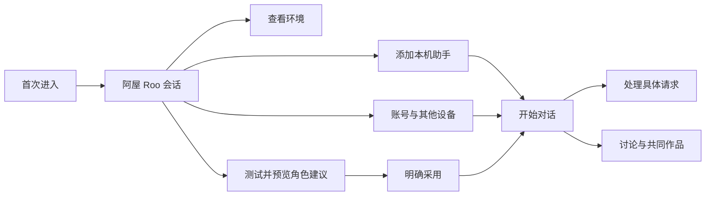

# AgentRoom 交互与视觉设计

本文对应 `v0.2.0-alpha.1` 的个人桌面。实现位置是 `apps/personal/src` 和 Electron 宿主；对象与执行规则见[详细设计](detailed-design.md)。[旧设计快照](design-history.md)保留早期 Matrix/Hullo 研究，不再定义默认个人界面的外观。

## 一个房间里的工作

用户先认识伙伴，再开始一段对话。聊天、待决定的事和作品之间保留明确联系。界面使用人的称呼、任务正文与可操作状态，内部协议和配置路径留在需要它们的设置或诊断视图。

核心入口为左侧导航、可收起的会话列表和当前内容。聊天、联系人、审批与作品共享这个框架。搜索、筛选和加号放在列表工具栏；常用会话可置顶。窄窗口在列表与内容间切换，并提供返回动作。

## 首次进入与重新引导

阿屋使用产品图标，欢迎语和会话持久保存。引导卡解释所选后端与配置证据，提供环境、本机助手、连接和角色入口。未找到可执行助手时仍能设置工作区和继续接入；连接失败应说明原因并保留原身份。

显示名称选填。「准备好了」完成引导，不强迫用户发消息或添加所有发现项。已有工作区沿用原入口，只有主动「重新查看引导」才回到阿屋；测试模式始终保留独立资料标识。详情见[引导设计](superpowers/specs/2026-11-12-roo-launch-design.md)。

## 添加和管理本机助手

“添加联系人”首先展示本机已有助手，搜索与“本机已有 / 发现更多”切换固定在顶部。已有助手保留最近聊过和一键打开，版本、更新、安装来源靠近对应助手，详细路径按需展开。“发现更多”展示官方目录中的原生程序与 ACP 适配器，未安装项目也能搜索，安装目标版本明确可见；完成安装不会自动创建联系人或发送消息。

目录刷新与本机可用性分开：联网失败不会阻断已有聊天，旧目录标明缓存与时间。作业显示进度和失败重试，关闭再打开继续查看；回执未知时核对原作业，不新建另一份安装。小窗口使用单列卡片与固定搜索/底部动作，沿用深色、键盘与减少动态效果设置。实现和验证见[助手管理](personal/assistant-management.md)。

## 联系人身份

| 身份 | 头像与展示 |
| --- | --- |
| 阿屋 Roo | 固定产品图标，后端名称放在引导说明。 |
| 自定义 Agent | 默认本地生成的 Bottts 机器人；seed、配色与白名单外观参数持久保存。 |
| 已发现的服务/CLI | 使用可用的服务图标或来源头像；已有用户选择按规则保留。 |
| 服务中的具体 Bot | 有经过验证的图片来源时展示它自己的头像，不以服务名覆盖身份。 |
| 人的联系人 | 圆形头像，可使用姓名缩写。 |
| 群聊 | 产品风格的默认群图案，或用户选取并本机处理的图片。 |

置顶快捷入口统一使用圆形轮廓；普通 Agent 头像仍为圆角方形。状态可表现为等待、执行、待决定和短暂完成动效，但状态变化不能重新生成身份。尊重「减少动态效果」，服务离线、配置不可用与需要用户处理应可用文字区分。实现参考 [ContactAvatar](../apps/personal/src/ContactAvatar.tsx)、[头像规则](../apps/personal/src/agent-avatar.ts)和[群头像验收](personal/group-avatar-acceptance.md)。

联系人详情把头像、名称、模型、思考深度、账户额度和主要动作整合成一张名片。模型是主要信息，额度区按服务实际返回显示剩余比例和重置时间；未知额度不画进度条。接入与身份说明按需展开，来源时间、旧观察和错误保持可见。视觉参考 [Raft 身份卡片](https://github.com/botiverse/raft-source/blob/1d689caf34442247cab70580d7feac1b8c302d60/packages/web/src/components/settings/SettingsProfileCard.tsx)与状态分区，沿用 AgentRoom 的字体、头像和语义颜色；不复制其组件实现。窄屏使用同一卡片的纵向布局，支持深色模式、高对比和键盘展开。

## 选择聊天伙伴与群成员

成员编辑使用固定标题和底部操作的双栏窗口：左侧搜索姓名、@用户名或助手来源，按全部、AI 助手、人类联系人筛选。可用助手优先显示，暂不可用的助手单独收起；搜索会展开匹配的不可用项，文字说明当前状态。同名联系人始终显示来源与唯一用户名，勾选不会重新排序。

右侧独立显示已选成员、人数和移除按钮，搜索或切换分类不会隐藏已选名单。本人自动加入，不计入待选人数。群名称与自动成员拼图集中展示，回复策略和允许静默按需展开；联系人设置从已选行进入，返回后保留草稿。缺失的历史联系人显示原 ID，只有主动移除才从待保存名单中删除。窄窗口改为上下分区，名单各自滚动，搜索和保存保持可见。

选一位开始或复用私聊，选两位及以上并填写群名创建群聊；旧群仍可保留少于三人的原身份与记录。合成验收入口为 `dev/contact-picker-acceptance.mjs`。

## 对话与决定

用户消息使用深蓝灰气泡，Agent 回复使用中性灰气泡；流式正文和最终正文保持同一回复位置。回复正文不重复堆叠模型、时间和身份标签，需要核查的来源可从联系人、运行记录和请求详情打开。

发送时保留之后继续输入的草稿。中文组词中的 Enter 不发送；Enter 发送，Shift+Enter 换行。提及列表支持键盘选择，引用回复保留被回复对象。群成员可按接受时的策略回复、回应表情或保持安静；失败不能伪装成静默完成。

请求卡说明来源联系人、原服务/设备、要做的动作以及可选择项。用户看见的是这一次请求的版本。普通聊天不再加一张重复的「是否聊天」审批；工具调用、创作方案和原服务决策在各自触发点展示。结果不确定时提供核查入口，避免用新的发送按钮暗示原写入已经取消。

## 作品与预览

群聊中的创作提议要能看见参与者和分工，用户确认后才开始相应写入。作品库保存作品身份和版本，对话保留共享关系。预览指向一个具体版本；文件保存成功、页面检查通过、用户接受和对外发布分别呈现。

本机 Finder 投影可能被人修改，因此冲突、待核查或未完成交换需要说明原状态。不要用旧的已交付页面掩盖新版本仍在检查，也不要把尚未验证的最新 head 当作交付结果。现有流程见[共同作品](personal/artifact-coauthoring.md)。

## Color

色值以 `messenger.css` 和相邻样式文件为实现依据，下表为当前浅色基线。深色模式使用对应语义变量，不对整页反色。

| 用途 | 色值 |
| --- | --- |
| 阅读背景 | `#ffffff` |
| 会话列表背景 | `#f3f5f7` |
| Agent 消息 | `#f2f2f2` |
| 主文字 | `#27343e` |
| 辅助文字 | `#5d6b77` |
| 操作与焦点 | `#35627b` |
| 用户消息 | `#294f68` |
| 等待用户的强调 | `#f2a93b` |

正文使用系统 SF/PingFang 字体栈。阅读行高和字阶以实际界面样式为准，较长 Markdown、宽表格和代码块保持可读并允许局部滚动。导航材料克制，阅读面保持不透明。当前视觉细节另见[视觉语言](personal/visual-language.md)与[macOS 设计](personal/macos-design.md)。

## 可访问性与验收

关键动作要有可读名称、键盘焦点和足够点击范围。对话列表收起后，用户仍能返回；缩窄窗口不能把导航永久藏起。放大文字、深色模式、降低透明度及减少动态效果都要保留功能，触控回复按钮不能覆盖正文。

选择器和测试标识以 [clients.md](clients.md) 为准。浏览器验证用于布局与交互；真实 Electron 验证固定 IPC、包内运行和生命周期。隐藏 renderer 截图不能被写成系统窗口、Dock 或物理设备验收。

## 后续设计

联系人申请将增加草稿、待处理、已接受、拒绝、撤销与过期的可见生命周期；当前设备目录接入不构成完整好友关系。引导中的自然语言建议将来可形成可审阅的动作提议，实际写入仍须经过对应产品接口与决定。先落实[实施方案](plans/architecture-evolution.md)中的身份和恢复规则，再补界面状态。
