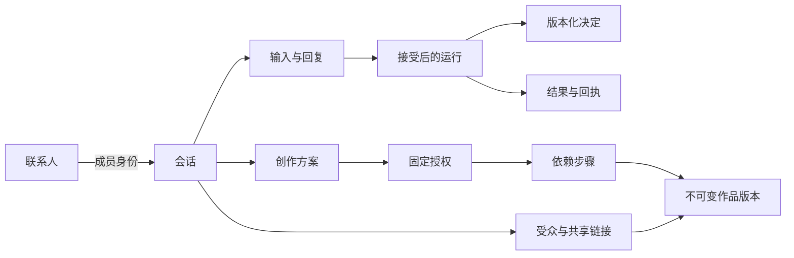
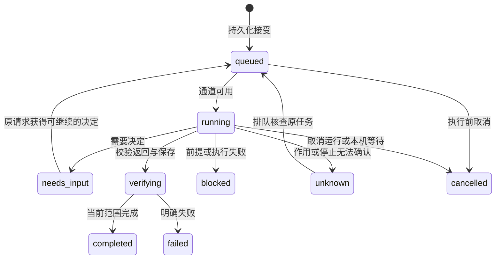

# AgentRoom 详细设计

状态基线：`v0.2.0-alpha.1`。本文解释当前实现；「后续设计」尚未编码。进程与部署见[架构](architecture.md)，交互见[设计](design.md)，具体字段以 [API](api.md) 为准。

## 对象与所有权

| 对象 | 关联 | 必须保持的规则 |
| --- | --- | --- |
| Contact | id、handle、身份指令、binding、configuration | handle 唯一，展示身份与执行后端分开；发现不覆盖用户编辑。 |
| Connection | 端点、协议、凭据引用及身份版本 | 同 URL 不同凭据不能共用旧授权，保存的 token 不进入普通界面或模型上下文。 |
| Thread / membership | 成员、加入位置、响应策略、版本 | 私聊复用原会话；群成员普通上下文不越过加入时的可见起点。 |
| Message | 正文、附件、来源、受众、引用与因果位置 | 群消息可产生多个运行，但用户输入只保存一次。 |
| Run | 原 messageId、contactSnapshot、executionSnapshot、独立状态字段 | 接受后的配置不随随后编辑漂移；流式进度不代替最终结果。 |
| Decision | 原运行/来源、版本、目标、payload 与选择 | 旧决定不能作用到新请求；用户选择不证明外部作用完成。 |
| WorkspaceArtifact / revision | head/current/delivered/accepted 指针、内容哈希 | 保存、物化、预览、交付和用户接受分别记账。 |
| grant / link | 固定参与者、版本、路径与受众 | 从已接受记录恢复工具身份，模型不能自行扩大权限。 |

领域记录在 SQLite 中按 kind 保存；这不表示每种对象已有独立表或服务。后续拆分先保留这些可观察行为。

## 阿屋与环境发现

`WorkspaceGuide` 以同一事务创建向导联系人、引导标记、私聊和欢迎消息。固定 ID 为 `agentroom_guide`，handle 从 `roo` 开始选择未占用值。重复读取/重启复用原记录，创建中断可以回滚后重试。

已有资料沿用原入口，新工作区直接打开向导。主动重开会清理作品导航参数，回到同一会话。完成引导只保存名字与完成状态，不自动发消息、建群或采用角色。

后端先看已保存的默认，再按 Codex、Claude、Pi 的固定顺序检查：已安装、支持执行、检测到登录配置，并能解析有效模型设置。这是产品默认顺序，不是模型能力排名。没有合格后端时保留连接入口；绑定后不因发现结果变化自动更换提供商。

向导在接受私聊消息时固定环境摘要：OS/架构/内存总量，最多 5 个本机助手、40 位已添加联系人、20 个连接。连接仅含 ID、名称和协议；不含端点 URL、凭据、配置文件原文或其他私聊。`executionVerified:false` 表示这份发现摘要本身不是运行证明。

阿屋复用现有界面辅助接入，没有任意扫描文件或对外发送好友申请的特权工具。角色建议另走随机挑战探测，通过后才分析用户选定的工作区来源；明确采用后才创建联系人。

实现：[workspace-guide](../apps/personal/server/workspace-guide.mjs)、[agent-onboarding](../apps/personal/server/agent-onboarding.mjs)、[引导 UI](../apps/personal/src/WorkspaceGuide.tsx)。

## 联系人与配置

发现清单、地址簿采用关系、执行可用性分别记录。系统可以发现未安装或未登录的助手，不把它伪装成可聊天状态。快速添加先验证整批候选，再采用稳定 ID，保留身份编辑与原聊天；添加不会发送问候。

本机 binding 指向具体 CLI。模型可跟随默认或明确固定，提供商/模型/思考配置在接受运行时解析保存。MCP 连接本身没有聊天模型，需要明确选择本机聊天后端。远端服务自行管理的模型不能套用本机参数。

人的联系人目前用于本机记录。导入设备目录表示登记了远端 Agent 入口，不表示对方接受了通用好友关系，也不授予原聊天或登录访问。

## 发送、顺序与上下文

客户端保存草稿和待确认的原请求。同一路由的相同 `clientId` 与相同指纹返回原回执，变更正文则冲突。丢失响应后重试原请求，不能覆盖用户后来输入的草稿。

接受群消息时固定身份、模型、成员策略和可见起点。上下文按原输入的因果顺序组织；后来的提问不倒灌进先前运行，前序回复按现有可见范围进入后续上下文。私有作品内容还需要授权检查。

`PersonalWorker` 是唯一模型执行队列，默认最多 3 个独立调用，可配置 1–8。同一会话/联系人的本机通道保持顺序，共享远端端点保守串行；旧任务和创作路径可要求独占。因此并发上限不等于任何时候都启动三个。

群成员按接受时的策略独立回复、回应允许的表情或静默。失败不等于静默；每条 Agent 回复不会自动唤醒全部成员，避免无界循环。创作批准后的有界委派另走工具路径。

实现：[Messenger](../apps/personal/server/messenger.mjs)、[worker/context](../apps/personal/server/runtime.mjs)、[IM participation](../apps/personal/server/im-participation.mjs)。

## 运行状态与恢复

这是主要产品路径。实际对象还保存 `phase`、`deliveryState`、`actionState`、`verificationState`。远端请求发出后，取消可只停止本机等待：记录为 `cancelled`，同时保留 `requiresReconciliation: true`，不证明远端作用已经取消。核查先进入 `queued / phase: reconcile`，再读取原 taskId/回执，不重新提交原写入；不是所有 unknown 都能安全恢复。

| 情况 | 处理 |
| --- | --- |
| 接受前连接不可用 | 返回明确问题，不生成假回复。 |
| 排队取消 | 保留原记录，阻止执行。 |
| 执行中停止未确认 | 保存 stopUnconfirmed / 核查标记，阻挡对应后端新工作。 |
| 远端回执丢失 | 有原 taskId 则 tasks/get；未知提交不自动重发。 |
| 写入返回成功、读回失败 | 保留回执与核验失败，不重放写入。 |
| utility 中断 | 恢复排队工作；中断执行按路径保留 blocked/unknown。 |
| 退出、休眠、离线 | 不承诺派发本机新工作；服务器已接收的工作按原任务核查。 |

实现：[store recovery](../apps/personal/server/store.mjs)、[runtime](../apps/personal/server/runtime.mjs)、[CLI adapters](../apps/personal/server/local-agents.mjs)。

## 决定与外部作用

| 入口 | 接受与回执 |
| --- | --- |
| 本机联系人聊天 | Send 接受身份/配置/上下文，CLI 保留自身权限。 |
| 指定 A2A 联系人聊天 | Send 绑定原端点和凭据身份直接发起，无重复聊天确认。 |
| 旧任务转交 A2A | 先预览目标及选定上下文，批准后发送。 |
| MCP 调用 | 先发现工具，再精确预览名称/参数/可选读回；批准只作用于该版本。 |
| 原服务审批 | main 保存原始选项与响应台账，utility 投影带来源的卡片。 |
| 共同创作 | 用户先确认方案与参与者，扩大路径/受众另行申请。 |

授权绑定端点和凭据身份，旧决定不能换到同 URL 的另一 token。远端返回成功不等于独立验收外部作用；MCP readOnlyHint 也不是权限证明。回显的已知凭据保存前去敏。

请求详情保留来源联系人、Bot/设备、原聊天和具体选择。模型不能用自称「已批准」绕过持久化决定。原服务取消、已处理或版本变化时，本地卡片按原状态更新；不确定的发送回执保留待核查。

## 共同作品

讨论中的 `creation_propose` / `creation_update` 形成针对当前用户消息的共同方案。参与者各自声明分工和依赖，文字声称加入不会生成参与记录。批准后，`CreationService` 固定授权版本，`CollaborationRuntime` 把有界依赖步骤交给原队列。

工具从已接受运行恢复身份和权限。Codex 私有 stdio MCP 与 Pi 可信扩展调用同一受认证 broker。等待依赖可保存检查点并让出通道，不增设模型执行池。

文档和网站有各自检查，网站等待宿主预览判定。head、物化、交付与用户接受的版本分开。renderer 通过 opaque `agentroom-artifact:` 能力在 sandboxed iframe 读取具体版本，不能自行提交检查通过；main 串行管理隐藏检查窗口与取消范围。

SQLite 保存身份、授权和版本指针；内容按 SHA-256 存储，版本清单不可变，current 是用户可见投影。人的修改、冲突和中断交换需要保留，不能直接覆盖。共享链接固定受众、路径及基准版本；用户可明确选择跟随该版本已交付的后代版本，不直接跟随任意 head。成员或绑定变化还影响有效权限。

本机预览不自动发布网站；真实模型共创、外部发布和用户接受另需验收。见[作品流程](personal/artifact-coauthoring.md)与[验收记录](personal/artifact-coauthoring-acceptance-2026-11-11.md)。

## 设备与节点

服务器节点保存自己的登录和 SQLite 任务，按节点串行处理。Mac 保存会话及原发送标识，断线后核查同一任务。节点异常退出或 CLI 停止未确认时保留执行栅栏，重启不自动解除。

Mac 共享仅开放主动选择的 Agent。本机 CLI 联系人在来源设备建立 `purpose:device_request` 会话执行，关闭 AgentRoom 创作工具入口，但保留原角色配置和 CLI 权限。缺少独立远端会话验收的个人服务/MCP 联系人目前只提供目录。导入联系人不再转发。

`device_request` 是远程执行记录，不是好友申请实体。目录每 15 秒检查，失联逐步显示重连/离线。可达、配置有效、额度和运行成功是不同事实；停止共享不表示已接受作用被撤销。详见[Mac 共享](personal/peer-devices.md)与[节点协议](personal/remote-nodes.md)。

## 存储、测试与发布

一个资料目录由 SQLite 锁保护，DB 使用 WAL。Bearer 密钥/密文受本机文件权限保护，备份需要原密钥。SQLite 无整库或端到端加密，同一系统用户下的进程仍属于本地隐私边界。

测试 profile 隔离应用 DB、分区、草稿与应用登录，外部 CLI 账户与配置仍可能共用。切换前冻结新写入，再检查活动/未知状态并确认原 utility 退出；测试模式不是 CLI 沙箱。

发布校验要求 clean 源码、包内 build-info、版本和构建回执对齐，再验证签名和 archive SHA-256。release.json 仅公开白名单来源字段。源码测试、实际包、公证、干净机器安装和真实升级分别验收。

## 后续设计的约束

收拢模块时保持 HTTP/IPC、稳定 ID、幂等、可见范围和恢复兼容。联系人申请需要独立生命周期，不能把连接或目录导入改名成好友系统。备份先解决一致快照，设备协作继续保留各自数据库归属。分期见[实施方案](plans/architecture-evolution.md)。
