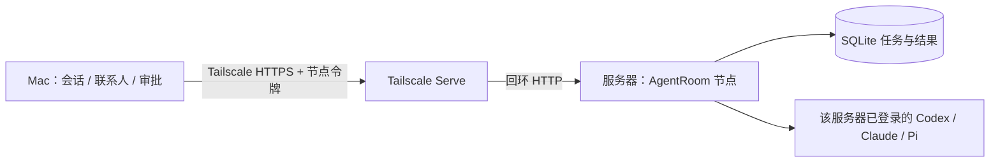

# 通过 Tailscale 加入其他服务器的 Agent

AgentRoom 支持多台服务器提供 Agent：每台服务器运行一个轻量节点，
Mac 的「连接与偏好 → 其他服务器」添加一次后，该节点开放的助手进入联系人，
可以私聊或加入已有群聊。聊天数据库仍由 Mac 保管；这不是多台桌面的数据同步。



## 在服务器准备节点

需要已加入同一 tailnet、Node **22.13+**、以及已安装并登录的 CLI。
复用项目代码即可，节点不需要 pnpm、Electron、Docker 或数据库服务器。
只开放明确选择的助手，不会自动复制其他电脑的登录。

```sh
node dev/agent-node.mjs init \
  --name MyServer \
  --agents codex,claude \
  --public-url https://myserver.example-tailnet.ts.net:19443
node dev/agent-node.mjs serve
```

`--state /absolute/private/path` 可分别传给 init 和 serve；默认
`~/.local/share/agentroom-node`。`--port` 默认 18749，只监听 127.0.0.1。
init 只创建一次，重复执行不会覆盖已有配置或令牌。服务不自行修改 Tailscale。

先查看 `tailscale serve status --json`，确认选择的监听端口未被其他项目使用，
再新增这一条（**不运行 reset，不开启 Funnel**）：

```sh
tailscale serve --bg --https=19443 http://127.0.0.1:18749
```

不同服务器可重复使用同一端口；同一服务器不能覆盖已有监听。
[Tailscale Serve 官方说明](https://tailscale.com/docs/reference/tailscale-cli/serve)
定义 tailnet 内的 HTTPS 转发。tailnet ACL 仍决定设备之间能否访问。
节点要求 HTTPS Tailscale DNS 根地址，本机隔离验收可使用回环 HTTP。

通过服务器已有的安全通道读取 state 中的 `access-token`，在 Mac 的添加表单
分别填写节点地址和令牌。令牌相当于调用这个节点开放的全部 Agent 的权限，
不要放在 URL、聊天消息、命令行参数、Git 或日志。Mac 用既有 AES-GCM vault 保存。
界面只显示检查时间、是否可达与远端安装/登录配置，实际账号和额度要以任务执行为准。

长期运行建议由服务器现有的 systemd/launchd 管理 `serve`，使用拥有 CLI 登录
的系统账号、绝对 Node/脚本路径及正确 PATH。不要切换账号或创建新的提供商配置。
同一 state 只允许一个节点进程；不同节点使用不同 state 和监听端口。

## 任务、断线与权限

- 节点 ID 随私有 state 持久化，改显示名称不改身份。增加开放助手后重新添加
  同一地址和令牌即可登记新增助手，不会复制已有联系人或替换其自定义身份。
- `message/send` 先落盘再回执。messageId 就是 taskId，相同正文重放返回原任务，
  同一编号换正文报冲突。Mac 在发送前保存 taskId，回执丢失仍能核查原结果。
- Mac 离线时服务器继续已经接收的任务；重新打开后对未知运行使用「核查结果」。
  不承诺在 Mac 退出、休眠或离线时派发新任务、主动收件或继续桌面定时调度。
- 节点正常退出后重启继续排队任务，保留完成结果。执行中断但没有结果的任务标为 unknown，
  不自动重跑。节点意外退出留下运行记录，或 CLI 子进程停止状态无法确认时，会持久保存 execution_fence 并暂停
  整个节点队列；须在服务器核查原进程及效果后由运维处理，重启不会解除保护。
- 任务按节点串行执行，队列最多 100 个待执行/运行任务，请求最多 2 MB。
  文本结果只证明 CLI 返回并保存了内容，不证明外部效果已验收。
- 网络请求不能传入 shell 命令、cwd、提供商或模型参数。CLI 使用独立工作目录，
  沿用现有适配器的 read-only/禁工具边界；cwd 和提示词不是文件系统隔离，已有
  CLI 插件仍按它们自己的权限运行。只有可信、自有的节点与设备应被登记。

## 移除与恢复

在节点列表逐个移除助手连接。进行中或待核查任务会阻止移除，原聊天和成果保留。
移除仅删除这个工作区的连接及本机密文，不会撤销已交给其他客户端的节点令牌。
停用整个节点时先处理任务，再停止它自己的服务，并仅关闭它自己的 Serve 监听：

```sh
tailscale serve --https=19443 off
```

撤销泄露的节点令牌时，停止节点、核对原任务，在私有 `access-token` 文件生成
新的随机 32 字节 base64url 令牌（权限 0600）并重启；各工作区须处理旧任务、移除
旧连接后重新添加。不允许用重新添加悄悄替换未决请求的凭据身份。
节点重建导致 ID 改变时也要先核对旧任务和旧连接。备份应包含完整私有 state，
不可让两个在线节点共用复制出的同一身份。不要把 SQLite 文件同步当作多机协作。

## 协议与研究依据

认证后的 `GET /.well-known/agentroom-node.json` 返回 `agentroom-node/1`、稳定
node ID、显示名称和助手列表。每个助手使用同源 `/agents/{codex|claude|pi}`
JSON-RPC，支持 A2A `message/send` 和 `tasks/get`；任务读取受助手 ID 约束。
它是当前个人工作区的独立入口，不是旧 Matrix bridge 的 Agent Protocol v0。

参考 [Raft 源码研究](research/raft-observation.md) 中的稳定身份、能力与身份分离、
任务持久化、精确回执与未知结果。实现没有复制 Raft 源码，也不提供共识选主、
数据库复制、自动转移执行所有权或高可用保证。

## 模型与额度名片

节点目录可附带 `agentInfo`，包含模型、提供商、思考深度、来源时间及适配器返回的额度。Codex 使用只读账户用量查询，不创建对话或调用模型；其他 CLI 未提供查询时明确显示不可获取原因。来源节点和接收端均需支持该字段；旧节点保持兼容，但名片数据未知。目录刷新失败时保留上次观察，不将旧额度当作新的执行许可。
