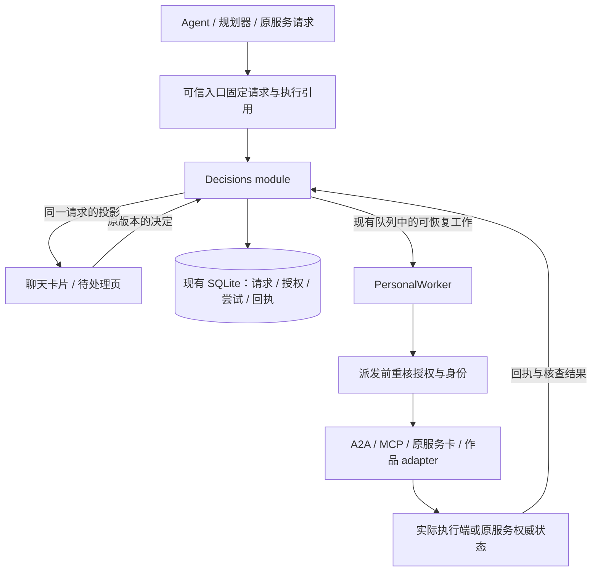

# AgentRoom 审批架构提案

日期：2026-11-13。[GET-530](https://linear.app/getyak/issue/GET-530/design-approvals-around-executable-requests-and-clear-authority) 的设计交付。交付范围为源码研究、独立设计和迁移方案；下述新接口与状态尚未实现。用户要求直接蒸馏 Raft，并由 agent team 从架构分析审批。本提案由三条独立研究汇总，推荐方案属于本次设计判断。

核读基线：AgentRoom `d91dfaf5b75e86ce38b8c32afde3645d5db5c5ea`；Raft `1d689caf34442247cab70580d7feac1b8c302d60`，发布标记 `v1.24.0-source.1`。Raft 参考工作树保留旧版本，因此研究读取固定 SHA 的 Git 对象，不能混用本地旧行号。只做静态源码、手册和测试合同核读，未运行 Raft、真实审批或外部写入。只提炼机制，未迁入其实现。

## 1. 推荐的架构

在现有自有 utility 内建立 Decisions module。它持有请求、决定、授权依据与投递恢复的规则；各 adapter 在实际执行入口落实权限，PersonalWorker 仍是唯一模型执行队列。聊天卡片与待处理页读取同一个权威请求。



模块必须同时覆盖决定和决定之后的派发准入。只给 runtime 返回 `approved: true`，会把身份检查、撤权、重试和恢复重新分散到各调用方。模块只调度现有队列中的固定工作类型，不接受 renderer/model 提供的任意 callback、URL、token 或工具实现。

## 2. Raft 值得抽取的机制

### 2.1 已准备的业务动作与运行时挂起的调用各有执行路径

Raft 的 Action Card 可以承载准备好的业务动作，由人以自己的会话提交；当前版本还包含问题表单、执行者权限表和有效期。`agent:approve_call` 则是另一条具体路径：Antiproton 挂起 hosted agent 的 mount 调用，Raft 负责把待决定的调用呈现给有权决定的人，再把选择交还 Antiproton。不能用旧版手册的少量动作类型概括当前实现。[R1][R2][R3]

AgentRoom 对应保留三类来源：本地准备的精确动作、provider 已挂起的操作、问题/选项。它们可以共享投影和回执设施，但不会因为共享一张卡片而取得相同执行权限。

### 2.2 一个权威操作，多张展示卡片

Raft 为同一 held call 保存一条审批记录。多位合格审批者可以各有 DM 卡片，卡片都指向同一个操作；点击时重新校验角色，先完成的决定由 provider 裁定，其余展示同步结果。卡片发给过某人，不构成该人此刻仍有审批权。[R2]

AgentRoom 用同一 `requestId` 支持聊天、待处理页和通知定位。`cardId`、`messageId` 仅标识展示位置，不能作为独立授权。人从群中移除、账号切换或 grant 撤销后，打开旧卡也不能继续执行。

### 2.3 执行端持有操作真值

Antiproton 的签名 hint 只带标识；Raft 验签后反查 provider，并定期 reconcile 补漏。provider 保存 `pending / approved / executed / failed / denied / expired`，Raft 的本地 `unavailable` 观察可被后续真实状态纠正。批准与执行结果分开，终态不能被旧观察倒退。[R2][R3]

AgentRoom 自己执行的精确动作由本地账本记录；Grok 原卡由 Grok 状态决定；远端 task 由远端任务回执决定。网络错误、卡片暂时缺失和列表截断都不能推导为拒绝、过期或完成。

### 2.4 记录是否真的把问题交给了人

Raft 单独保存首张卡片已提交或没有接收者的事实，并持久化待报告状态，reconcile 补报。这让“发给了人但无人决定”和“根本没找到人”可区分。[R2]

AgentRoom 应分别记录请求已保存、界面可见、通知投递与人的决定。没有合格审批者是待恢复问题，不把它显示成用户拒绝；超时也要保留是否实际展示过请求。

### 2.5 重试依赖对端合同

Raft 的 held-call decide 可在网络错误或 5xx 后按原操作和原决定重试，依据是它与 Antiproton 约定的单 hold 原子决定合同。该仓库的 fake-provider 合同测试不能证明 Antiproton 生产实现的执行原子性。此链还要求 provider 配置与 hint 公钥齐备，源码存在不证明任意部署已启用。不能把这条重试策略用于任意工具或现有 Grok 回传。AgentRoom 对回执不明的外部写入继续保留 unknown，先读回原 operation/task；只有 adapter 明确声明稳定幂等重放能力，才允许自动重送。[R2][R4]

## 3. AgentRoom 当前事实与需要修正的地方

| 当前位置 | 当前行为 | 设计上的影响 |
| --- | --- | --- |
| `index.mjs:505–525` | 路由同时执行幂等、版本校验、记录选择、推进 run 和触发同步。 | 领域决定与传输耦合，新增入口容易漏检查。 |
| `runtime.mjs:685–703,778–829` | A2A 旧任务和 MCP 路径自行建卡、绑定身份、执行请求。 | 共同规则分散，应收拢到同一请求生命周期。 |
| `provider-approvals.mjs:23–69,90–109` | 原卡投影、回答台账、状态同步和 run 恢复放在一起；accepted/resolved 会推进 action/verification。 | 回答送达与任务结果需要拆开。 |
| `provider-approvals.mjs:76,85–95` | 查历史回答时按 cardId 对应的 decisionId，未同时区分请求内容版本与观察版本。 | 同卡内容实质变化后的 pending 请求不能继承旧答案；正常 resolved 更新仍应核查原 Attempt。 |
| `personal-services.ts:313,327` | main 查回执、拦重复尝试都只按 instanceId/cardId。 | 新请求代际与回执台账必须在 main/utility 一起迁移，不能只修投影后仍被旧回执挡住。 |
| `Messenger.tsx:403–406` | 聊天显示审批提示条，卡片主要在单独页面。 | 同一对象应支持上下文内处理。 |
| `creation-service.mjs:21–42`、`tool-sessions.mjs:54–67` | 作品工具重核 run、成员、binding 与固定 grant。 | 这是现有可复用的授权执行基础。 |
| `grokbot.ts:716–720` | 本机权限标为 `originalAppOnly`。 | 该性质必须保留到两端强制校验，不能只变成摘要文字。 |

以上为静态实现事实。[A1][A2][A3][A4][A5][A6][A7][A11] `originalAppOnly` 当前通常因没有 choices 而不可回传；utility/host 没有把该标记作为独立拒绝条件。这是需要补强的合同，不宣称已证明线上存在可利用路径。

## 4. 比较过的方案

| 方案 | 收益 | 成本与限制 |
| --- | --- | --- |
| 保留三条流程，仅统一卡片 UI | 改动小，可先改善上下文与文案。 | 决策状态、身份和恢复继续分散，只适合作为迁移第一步。 |
| Decisions module + 真实能力的 adapters | 统一请求、决定、授权与恢复；复用 SQLite、队列和作品 grant。 | 要定义派发准入与 adapter 合同，逐条迁移。**本提案推荐。** |
| 独立通用权限服务与规则平台 | 适合未来多租户部署和统一组织策略。 | 当前一人一工作区会增加进程、同步与身份系统，无法替缺少拦截能力的执行器补出能力。 |

## 5. 领域对象与权威来源

| 对象 | 保存什么 | 权威来源 |
| --- | --- | --- |
| Request | 问题/选项/授权类型，原聊天/run，提议者，请求版本，原始选项，冻结 effect 引用。 | utility 的可信接受入口；provider 原卡保留其原版本和操作标识。 |
| Decision | 人选择了什么，提交者 principal，版本，commandId，时间，授权依据。 | 经当前权限校验的人类操作或已有明确 grant。模型文字不能自行形成决定。 |
| Grant | 哪个主体可让哪个执行器，对哪些资源做哪些操作，预算与有效期。 | 工作区 owner 或协议明确指定的 authority。 |
| Attempt | operationId、精确 payloadHash、身份绑定、预算预留、派发意图和外部引用。 | 实际派发入口与对应 adapter。 |
| Receipt / Evidence | 回答是否送达、provider 报告的结果、独立读回及其核验范围。 | 指定 source；来源、能力和观察时间同时保存。 |
| Projection | 卡片/通知的位置与可见范围。 | 从 Request/Decision/Receipt 派生，不另存可竞争的决定。 |

`Request.kind` 使用有明确分支的 `question / choice / authorization`。恢复连接和执行故障可以出现在待处理页，但不伪装成授权请求。原服务 opaque choice 默认仅回答该卡，不能创建本地 grant。

每次效果固定四个主体：`requester` 是谁要求做，`proposer` 是谁提出方案，`executor` 是谁实际执行，`approver` 是谁有权授予范围。另保存 credential 的不透明绑定及可验证程度。联系人昵称、Bot 名和共享 Bearer 都不能代替独立账号身份。

## 6. 模块接口与执行 seam

下面是拟议调用形状，不是已发布 API。`trustedContext` 来自认证宿主、已接受 run 或固定工具 broker，不能由 renderer/model 自选 principal。`effectRef` 与 `continuationRef` 指向已保存且不可变的领域记录。

```ts
interface Decisions {
  request(spec: RequestSpec, trustedContext: TrustedContext): RequestReceipt;
  respond(command: AnswerRequest | RevokeGrant,
    trustedContext: TrustedContext): DecisionReceipt;
  read(query: RequestQuery, trustedContext: TrustedContext): RequestView[];
}
```

`request` 固定身份、输入和能力。可复用的明确 grant 足够覆盖该精确动作时，记录授权依据并安排现有队列继续；确实缺少决定时保存待处理请求。`respond` 校验当前审批权、有效期和精确版本，并原子保存决定与后续工作。它不承诺该动作已完成。`read` 从权威记录生成与调用者可见范围一致的投影。

自动复用 grant 首先适用于 AgentRoom 实际控制的精确动作。provider held call 是否允许由已有 grant 自动决定，必须由 provider 的授权合同明确支持；本地 scope 足够不代表获得了该 provider 的决定权。opaque choice 只接受人的原始选择；`original_app_only` 始终交回原应用。把三条路径共用投递设施，不会改变各自派发依据。

`AnswerRequest` 固定 requestId、expectedRevision、commandId 与带类型的 answer；回答分别是文本、原始选项 key 或对确切 scope 的 allow/deny。`RevokeGrant` 固定 grantId、expectedAuthorityEpoch 与 commandId，只能由有权撤销该 grant 的 principal 提交。读取和普通 Agent 请求不能借此生成 owner 权限。

普通 caller 示例：MCP 规划器保存固定工具/参数/可选读回的 `effectRef`，然后调用 `request`；UI 带原 revision 与 commandId 调用 `respond`；PersonalWorker 消费固定的 continuation，并由模块内部 adapter 在派发准入后执行。业务 caller 不再自行解释 `approve` 并调用 RPC。

构造模块时注入 storage、clock、当前 authority resolver、现有队列和 adapters。provider 观察、轮询、投递与恢复在内部 seam 处理，不把 `tick/project/choose/register` 暴露给普通业务调用方。HTTP、IPC 的旧路径在迁移期保留为兼容 adapter。

派发准入是本地事务中的明确点：重核 grant、requestRevision、身份/session epoch、资源/audience 版本与剩余预算，保存 Attempt 与 dispatch intent；提交后才进行网络调用，不跨网络持 SQLite 写锁。PersonalWorker 的 lane/fence 规则保持，不能另建第二个模型池。

**dispatch claim 事务提交是这次授权消费的线性化点。** 它不证明网络已经发送。撤权先提交，后续 claim 必须失败；claim 先提交，撤权可以请求取消本地未发工作或请求停止，但不保证阻止这一次外部作用。adapter 在可行时检查尚未发送的撤销；数据库与网络间无法原子提交，不能把这种尽力检查宣传为强取消。claim 后崩溃且无确定回执，按 unknown 核查同一 Attempt，不能重新建 operation。

## 7. 能力声明决定能提供哪些保证

每个 adapter 对每类操作分别声明下列事实。声明由可信实现提供，不能直接信任远端工具自述。

```ts
type OperationCapability = {
  interception: "exact_call" | "provider_card" | "submission_only" | "none";
  authority: "agentroom" | "provider" | "original_app_only";
  grants: ("once" | "task_scope")[];
  receipts: ("accepted" | "outcome" | "readback")[];
  cancellation: "none" | "request_only" | "confirmed_stop";
  reconciliation: "operation_id" | "task_id" | "none";
  replay: "never" | "same_operation_idempotent";
};
```

| 当前路径 | 可控制的入口 | 当前不应承诺的能力 |
| --- | --- | --- |
| MCP | utility 发起的精确 tools/call。 | 根据 readOnlyHint 自动取得可信授权；控制工具服务内部所有副作用。 |
| 作品工具 | 已批准参与者、路径、版本和有界子任务。 | 任意文件系统与账号操作。 |
| Grok widget | 原卡 ID、revision 与原始 choice 的回传。 | 回答 accepted 即业务完成。 |
| Grok 本机权限 | 观察原应用的请求和处理结果。 | AgentRoom 代替原应用授予本机权限。 |
| 普通 A2A / 服务器节点 | 发送对象、材料、稳定 messageId 及原 task 查询。 | 逐项审批远端工具、强取消、跨调用者授权隔离。 |
| 本机 CLI 普通聊天 | 启动配置与进程管理；部分路径限制工具。 | 已接入所有 CLI 原生审批协议。 |

Codex 当前普通路径为 `exec --json` 和 read-only；Claude 受 plan/禁工具等参数约束；Pi 默认禁工具，作品域按受控 broker 开放。它们各自的约束应保留，后续 CLI approval bridge 要逐驱动实现和验收。[A8] `original_app_only` 在 utility 与 main 两处拒绝 respond，即使上游以后附带 options 也不改变权限归属。[A3][A7]

## 8. 授权复用、多 Agent 与远端所有权

用户明确授予任务范围后，范围内动作继续自动完成。每次调用仍有独立 operationId、精确参数和回执；只在缺少信息或扩大范围时请求新的决定。发送普通聊天已表达该联系人的发送意图，不能重复增加一轮聊天确认。

`authorityEpoch` 与 `recordVersion` 分开。前者表示账号、端点、成员/受众、范围或凭据发生了授权相关变化；后者可以因进度和回执更新而递增。收到了进度不应让 grant 失效。对账号真实身份不可测的 adapter，明确保存 unknown，并只承诺其可验证的凭据绑定。

provider 还要区分 `requestGeneration / semanticRevision` 和 `observationRevision`。Grok 原 revision 包含 updated_seq 与 widget 状态，正常回答后也会改变；它能让旧按钮失效，却不能单独证明出现了新操作。UI 的 expectedRevision 固定当时可操作的请求版本；grant 仍按独立 authorityEpoch 判断，不因普通观察更新要求重复授权。

核查旧回答时，用稳定 source/card/operation 及原 answer Attempt 关联新观察，不产生新派发。原卡 resolved 可能来自原应用或另一设备；只有来源回执、原操作标识和实际选择等证据足够匹配时，才确认本机 Attempt 的投递。否则原请求可记“已在别处处理”，本机投递保留 unknown。pending 的内容/选项实质变化可形成新的待审内容，重新派发还必须确认其为新请求代际，或原 Attempt 已有确定结论；无法辨明操作标识是否重用时不再次写入。摘要 hash 只能辅助比较，不能冒充 provider 的操作身份。

main 与 utility 的去重和回执索引都绑定相同逻辑请求键：source generation、card/operation ID、request generation；原 observation revision 用于回答时的 CAS。正常回答后的状态 revision 变化用于对账，不创建第二次 Attempt。确定的新代际不被旧 accepted 回执永久挡住；旧 unknown 仍按实际共享会话的 fence 保护，不能仅换一个本地 requestId 绕过。

Grant 应限定任务、executor/credential binding、允许动作、资源/路径、接收人/受众、预算与到期时间。预算在派发事务内预留，结果不明的 Attempt 保留预留，不能因超时立即退回后再次消费。撤权阻止后续派发；已发到远端的动作另走停止和核查，不能声称回滚。

子任务权限必须是父 grant 的子集，委派本身也要在父范围中；新增执行者、外部接收人、账号或资源范围需要新的明确依据。群内多个 lane 只保证调度顺序；多个 Agent 共用一个 CLI 登录时，没有因此取得 OS/账号隔离。[A5][A6]

当前同 owner 的设备共享没有完整 peer principal。扩到好友调用前，先增加每 peer 凭据与撤销、peer→contact 调用 grant、task 的 requesterPrincipal，以及查询/审批归属校验。远端请求进入本机不能自动借用本机 `self` 成为 owner；调用方可以提议，来源 owner 才能按协议决定使用自己的资源。[A9][A10]

## 9. 状态、持久化和恢复

避免把整条链压进一个 `state`：

| 维度 | 拟议状态 | 推进依据 |
| --- | --- | --- |
| 请求 | open / answered / superseded / withdrawn / expired | 原请求和被接受的决定；provider expiry 以 provider 真值为准。 |
| 回答投递 | queued / sending / acknowledged / unknown / rejected | 响应台账和对端回执。 |
| 本地授权 | not_applicable / active / denied / revoked / expired | 有权主体形成的 grant 与当前 authorityEpoch；原服务的 opaque choice 不产生本地 grant。 |
| 实际动作 | not_started / held / running / succeeded / failed / unknown | 对应 executor 的结果合同。 |
| 核验 | not_requested / pending / verified / failed / unavailable | 明确证据及其覆盖范围。 |

例如 Grok 卡片已被回答，可显示“选择已送达，正在等待任务结果”；没有业务结果就不推进 succeeded。原服务显示权限已拒绝或过期时，也不能仅因原卡 resolved 标作动作完成。

仍使用现有 SQLite documents 与短事务；拟新增带 schemaVersion 的请求、决定、grant、attempt、delivery job 记录。决定、幂等回执和待派发工作在同一事务提交，网络结果另一次事务记录；通知提交后发出，漏通知可通过重新读取恢复。

同 commandId、同 fingerprint 返回原接受回执；同键不同内容冲突。requestRevision 冲突返回最新投影，旧卡禁止提交。effect 的精确 payloadHash 与 grant 允许范围分别校验：参数可以在已批准范围内变化，但任何一次 Attempt 的参数都不可在派发后改写。

崩溃时按持久状态恢复：未派发的工作重核准入；已 dispatch 而无回执的 Attempt 标 unknown；能够 query 的 adapter 查询原 operation/task；只有明确幂等合同允许同 operation 的重送。取消记录“本机停止等待”“已请求停止”“远端已确认停止”三种事实。一个 Agent 等待决定，不阻塞无共享状态的其他 lane；同账号/会话的 unknown fence 继续保护后续提交。

## 10. 迁移顺序与验收

1. **先修正事实表达。** 分开原卡处理、回答送达、任务结果和核验；补 original-app-only 两端强制；列出 adapter 能力。保留现有 IPC/HTTP 路由和 ID。
2. **收拢请求与决定。** 将路由、runtime 和 provider 投影中的共同规则迁入 Decisions module；provider 原标识与 main 的原始选项映射保留。main/utility 的原卡代际、回执查找与重复尝试保护一起迁移。聊天和待处理页读取同一请求。
3. **持久化派发与恢复。** 在现有 worker 中引入固定 continuation/Attempt/delivery job；兼容读取旧 Decision，不能用迁移把未知记录补成完成、verified 或持续授权。迁移幂等，保留 schemaVersion 和旧引用。
4. **复用任务 grant。** 从现有作品域抽取权限检查，先覆盖已受控的作品/MCP 动作，再按真实能力开放一次/任务范围授权。先保留精确预览，不提前普遍自动放行。
5. **扩展执行器。** CLI approval bridge、节点审批协议和 peer principal 分期实现。每个 adapter 的真实提供商/设备验收单列；已有协议不能通过 UI 改名获得新能力。

本次只交付提案。未来每期关联独立 Linear/PR，按实际实现与验收关闭，不以本研究完成代替产品上线。

最低反例集：同名 Bot 不串卡；两处同时回答只接受一条有效决定；原卡换观察 revision 后旧按钮失败、正常 resolved 更新仍可核查旧 Attempt、实质变更的 pending 请求不继承旧答案；同卡确定的新代际在 main/utility 都不被旧 accepted 回执挡住；原应用先回答而本机 Attempt 无回执仍保留 unknown；撤权与 claim 两种提交顺序以及 claim 后网络前崩溃；original-app-only 带 options 仍拒绝；授权未扩展时受控的连续工具调用不重复问、provider 不允许自动决定时本地 grant 不越权；新增收件人/参与者触发新决定；子任务不能扩权；预算并发预留不超限；provider 已答但 ACK 丢失不重复副作用；重启只核查原操作；旧状态不能覆盖新终态；原应用拒绝/过期不映射业务成功；取消等待不冒充远端停止；未经授权的 peer 无法查别人的任务；后续消息不能抹掉旧请求已经派发或 unknown 的事实。先通过模块公开 interface 验证，再做受控 adapter 故障注入；真实账号结果另记。

## 源码索引

Raft 链接固定到本次新快照。历史研究继续按各自旧版本阅读，不从旧文档推定新实现。AgentRoom 链接固定到研究基线，避免后续行号漂移。

[R1]: https://github.com/botiverse/raft-source/blob/1d689caf34442247cab70580d7feac1b8c302d60/packages/server/src/services/actionCardsService.ts#L1218
[R2]: https://github.com/botiverse/raft-source/blob/1d689caf34442247cab70580d7feac1b8c302d60/packages/server/src/services/agentRuntimeApprovalService.ts#L1
[R3]: https://github.com/botiverse/raft-source/blob/1d689caf34442247cab70580d7feac1b8c302d60/packages/server/src/services/agentRuntimeApprovalItem.ts#L21
[R4]: https://github.com/botiverse/raft-source/blob/1d689caf34442247cab70580d7feac1b8c302d60/packages/server/src/routes/antiprotonApprovals.api.test.ts#L1
[A1]: https://github.com/getyak/agentroom/blob/d91dfaf5b75e86ce38b8c32afde3645d5db5c5ea/apps/personal/server/index.mjs#L505
[A2]: https://github.com/getyak/agentroom/blob/d91dfaf5b75e86ce38b8c32afde3645d5db5c5ea/apps/personal/server/runtime.mjs#L685
[A3]: https://github.com/getyak/agentroom/blob/d91dfaf5b75e86ce38b8c32afde3645d5db5c5ea/apps/personal/server/provider-approvals.mjs#L23
[A4]: https://github.com/getyak/agentroom/blob/d91dfaf5b75e86ce38b8c32afde3645d5db5c5ea/apps/personal/src/Messenger.tsx#L403
[A5]: https://github.com/getyak/agentroom/blob/d91dfaf5b75e86ce38b8c32afde3645d5db5c5ea/apps/personal/server/creation-service.mjs#L21
[A6]: https://github.com/getyak/agentroom/blob/d91dfaf5b75e86ce38b8c32afde3645d5db5c5ea/apps/personal/server/tool-sessions.mjs#L54
[A7]: https://github.com/getyak/agentroom/blob/d91dfaf5b75e86ce38b8c32afde3645d5db5c5ea/apps/desktop/src/main/connectors/grokbot.ts#L716
[A8]: https://github.com/getyak/agentroom/blob/d91dfaf5b75e86ce38b8c32afde3645d5db5c5ea/apps/personal/server/local-agents.mjs#L313
[A9]: https://github.com/getyak/agentroom/blob/d91dfaf5b75e86ce38b8c32afde3645d5db5c5ea/apps/personal/server/desktop-sharing.mjs#L115
[A10]: https://github.com/getyak/agentroom/blob/d91dfaf5b75e86ce38b8c32afde3645d5db5c5ea/apps/personal/server/agent-node.mjs#L129
[A11]: https://github.com/getyak/agentroom/blob/d91dfaf5b75e86ce38b8c32afde3645d5db5c5ea/apps/desktop/src/main/personal-services.ts#L311
