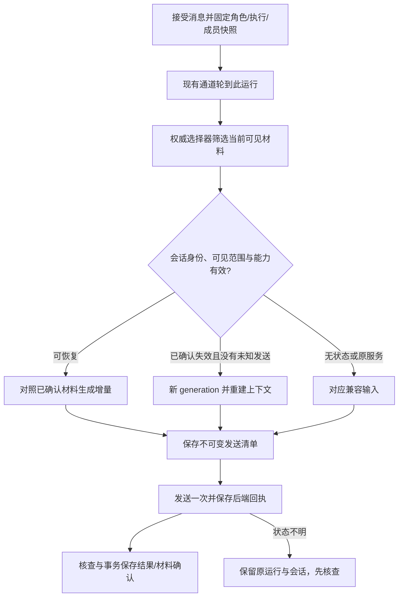

# 联系人独立会话与上下文传递优化

日期：2026-11-14。关联：[GET-556](https://linear.app/getyak/issue/f91d897c-f59f-4a2e-a1be-131686f56d83)。代码核对基线：`getyak/agentroom` main `fbd8790`。

状态：设计提案，尚未实现。本文交付架构、兼容边界及验收标准，不改变当前 API、后端行为、安装包或服务。用户已选择“每位联系人在每个聊天里保留独立会话，可续聊时只传新增内容”的方向；下文的数据结构、预算、启用次序是设计建议，不是用户逐项指定的实现。

## 1. 要解决的问题

联系人代表身份，AgentRoom 聊天代表用户可见的记录，后端会话代表执行助手实际保留的上下文。这三个对象不能合并：两个角色可以使用同一个 CLI，一个角色可以参加多个群，同一个个人服务可能始终使用它原来的一个对话。

目标是让后端已经拥有的内容不再被 AgentRoom 反复注入，同时保留连续理解、群成员可见范围、来源授权和未知结果保护。联系人数量不会成为上下文大小的理由：不得注入整个通讯录、其他私聊或未选中的记忆。

主要成功标准是同一后端会话中第二轮及之后的历史重复传递量下降。传输字节减少不直接等于模型输入 token、费用或响应时间同比下降，供应商仍可能处理完整会话；分别测量，缺失的指标保持未知。

首版面向普通 Messenger 联系人聊天。旧任务转交、引导分析、自动目标运行、公开访客执行、项目授权、共创以及带原生工具/MCP 的轮次，先保留现有路径，直到各自的权限与恢复回归通过。它们不会因为底层使用同一个 CLI 就自动获得会话复用。

## 2. 当前代码事实

| 路径 | 当前行为 | 对设计的影响 |
| --- | --- | --- |
| `apps/personal/server/runtime.mjs` 的 `messagesForRun` / `threadContext` | 依据当前请求、成员边界、受众、资料读取依赖和授权筛选历史，组装身份、参与者、消息、附件和记忆；记录 supplied 输入回执。 | 继续作为可见材料的权威选择器；supplied 不代表后端已经记住。 |
| `apps/personal/server/local-agents.mjs` | 普通 Codex 使用 `--ephemeral`，Claude 使用 `--no-session-persistence`，Pi 使用 `--no-session`；执行快照固定实际模型和启动坐标。 | 不能直接删掉历史；先实现并验证后端的独立会话保存、恢复和身份检查。 |
| `apps/personal/server/acp-client.mjs` | 每次运行启动自有进程、`session/new`、`session/prompt`，结束关闭进程组；当前没有复用保存的会话。 | ACP 接入不自动意味着可恢复。只启用经验证可跨进程恢复的具体适配器。 |
| personal runtime 的 A2A `message/send` | 发当前请求与过滤后的上下文，保存任务回执；此路径当前没有按聊天续用返回的 `contextId`。 | 普通 A2A 默认继续无状态上下文；不能拿 `taskId` 当会话 ID。 |
| `apps/desktop/src/main/personal-services.ts` 及 connectors | 服务使用自身已有对话；本机 A2A 门面转发收到的文本，并以实例 ID 返回 `contextId`。 | 该 ID 不是“每个 AgentRoom 聊天都隔离”的证据，也不能直接当作新会话能力。 |
| `messenger.mjs`、ChatTools、Creation、Decisions | 接受时固定角色/执行/成员，执行与结果保留来源、权限、精确决定和核查记录。 | 新会话层复用这些规则，不另造发送队列、授权或自动重试系统。 |

保留的 Matrix/Go 适配器具有自己的 session/context 实现，不能用它的能力推断默认 personal 路径已经支持；本提案不修改该兼容路线。

## 3. 方案取舍

| 方案 | 收益 | 代价与选择 |
| --- | --- | --- |
| 所有后端继续临时调用，每次发送过滤历史 | 当前行为兼容，恢复容易。 | 历史重复、长聊天增长；作为兼容路径保留。 |
| 所有联系人强制改成长驻助手进程 | 活跃进程中容易保留状态。 | 不能解决远端单一服务会话，联系人多时增加本机资源占用；不采用。 |
| 按已验证能力绑定独立后端会话，增量传递，兼容无状态与原服务会话 | 与用户选定方向一致，允许逐个接入启用。 | 需要明确回执、失效和权限规则；采用。 |

优先保留后端可冷恢复的会话标识，不给每个联系人保留一个常驻进程。继续复用现有 worker、通道和并发限制；这里只增加运行数据与适配器契约。

## 4. 会话归属

一个可复用会话的作用域为：

```text
workspace/profile + threadId + contactId + membershipEpoch
  + bindingFingerprint + executionFingerprint + visibilityEpoch + generation
```

- `workspace/profile`：桌面、辅助 Web、测试资料各自独立，不从用户 CLI 历史或别的 profile 中挑选会话。
- `threadId + contactId`：同一联系人在私聊、群 A、群 B 中分别拥有后端会话；同一 CLI 的两个角色也分别保存。
- `membershipEpoch`：退群后重入是新边界，不能恢复退出前的会话。
- `bindingFingerprint`：后端类型、稳定实例/节点/运行时身份、端点、凭据引用和版本的摘要；不保存凭据明文。不能只按 URL、显示名称或 CLI 名称匹配。
- `executionFingerprint`：实际 provider/model/thinking、运行时版本/启动坐标、角色指令及执行策略版本。首版变化即开启新 generation；改头像、颜色或纯展示名称不触发。
- `visibilityEpoch`：当前受众、资料/记忆/工具/项目授权与来源版本的修订。任一修订要求重新校验所有已保留内容；已保留内容不再满足当前可见范围时必须新建 generation。
- `generation`：同一聊天内的后端上下文代次。会话丢失、上下文不兼容或明确重置时增加，原 AgentRoom 聊天记录保留。

后端会话只接受应用创建且记录了上述作用域的 ID。恢复“CLI 最近一次聊天”、从磁盘搜索其他聊天、仅凭返回一个同名 ID 就复用，均不属于恢复。

首版创建普通私聊会继续复用现有 direct chat；不引入一个联系人下的多条私聊 UI。后台模型会话与用户可见聊天的生命周期分开。

## 5. 后端能力契约

能力来自具体适配器版本和隔离验收，不由模型自述、安装检测、登录态或配置文件推定。能力记录至少包含 `mode`、证据版本/时间、作用域绑定、能否冷恢复、能否核查输入接受及未完成结果。

| 模式 | 使用条件 | 传递方式 |
| --- | --- | --- |
| `stateless` | 默认；会话隔离或恢复未验证。 | 当前过滤上下文；后续单独验证有预算的重建输入。 |
| `resumable` | 创建、独立绑定、同一 ID 恢复、身份核对、增量接受和崩溃恢复均通过。 | 首轮 bootstrap，后续发送新增材料与本轮必要控制信息。 |
| `shared_service` | 服务只能继续原有对话，不能证明按聊天创建和恢复。 | 限定到唯一允许的 AgentRoom 私聊；只提交本轮必要请求，不重复注入本地完整历史。 |

`shared_service` 需要先验证稳定服务会话身份、人工操作导致的页面切换/新消息检测和回复关联；未通过时保留现有行为，不先删上下文。实例级独占通道继续有效。连接只映射一个联系人/私聊，不用于新群聊或第二角色；既有冲突保留记录并阻止新派发，界面提示打开原服务核查或选择支持独立会话的后端。不复制账号、不擅自创建服务会话、不删除历史绑定。

用户在服务原 App 发过消息时，服务原会话本身仍可用于该唯一私聊，但 AgentRoom 不声称掌握完整历史。检测到会话切换、在途人工输入或回复归属不明时，进入核查状态，不猜测回复属于哪个运行。

`resumable` 的最小适配器接口为 `create(scope)`、`load(handle, scope)`、`send(turn)`、`inspect(receipt)`、`retire(handle)`。这是内部设计，不是新增公共 API 的既成契约。`retire` 默认仅停止本地复用，不意味着删除供应商聊天；没有删除能力时明确保留远端数据状态。

具体接入约束：

1. Codex/Claude/Pi：每种 CLI 分别验证冷恢复和每次执行的模型、沙箱、工具限制。当前禁用持久化的参数不能直接删掉了事。不假定三种 CLI 的恢复参数、历史结构或取消语义相同。
2. ACP：核对具体助手的初始化能力和跨进程加载能力；只保持进程内状态的助手首版继续无状态，不为了保活新增常驻进程池。当前拒绝客户端文件/终端/权限请求的边界保持。
3. A2A：验证独立 context 语义，后续把已验证的 `contextId` 放入对应消息协议字段，任务仍用独立 `taskId` 核查。个人服务门面与普通 A2A 分开判断，未知 context 不能自动重发原请求。
4. 服务内没有可靠的“已消费输入”证据时，不把 `submitted` 或网络 200 当成完整历史提交；完成/核查证据达到该适配器的接受契约后才允许下一轮增量。

## 6. 存储与一次发送

使用现有 `PersonalStore` 的 documents 与事务，增加 `conversation_session` 和按运行保存的输入清单，不引入第二份聊天数据库。

| 对象 | 必需内容 |
| --- | --- |
| `conversation_session` | 内部 ID、作用域及 generation、模式/能力证据、后端 handle 的私有引用、状态与版本、已确认材料/输出的索引、依赖来源与当前未决运行。 |
| `run.contextDispatch` | schema 版本、session/generation、当前消息、按顺序的来源 ID/版本/内容 hash、模式（bootstrap、delta、rebuild、stateless、service_turn）、固定的控制信息与摘要引用、payload hash、字节数、接受/完成回执。 |
| 可选 `context_checkpoint` | 本会话可见来源 ID/hash、摘要文本与生成方式、覆盖范围、授权依赖、截断/省略说明、版本；禁止来源不明的“全局记忆”。 |

后端 handle、私有回执及本机会话文件存放在应用拥有的资料目录/私有引用中，不作为 renderer URL、诊断正文或其他联系人可读资料。会话文件可能含完整文本，采用与个人资料相同的权限、备份与保留要求，不在共享临时目录保存。

发送流程：



接受消息时固定业务快照；轮到该 Agent 的通道时才选择因果历史并固定发送清单，让 M1 的已完成回答 A1 可以进入排队中的 M2。固定后不能在重试时混入后来 M3、后来角色配置或另一 generation。发送前重新校验身份与权限：与已固定清单冲突时使未发送运行失效，不能静默改写既有预览或 payload。

增量不是“取最后一个时间戳之后的消息”。从权威选择器输出中减去该会话已确认保留且版本/hash 相同的材料，再按原来的因果顺序发送。消息、附件内容版本、明确记忆版本、成员元信息和可见反应各有稳定标识；延迟到达但因果上更早的回答不会被单一高水位漏掉。

每轮都发送当前消息 ID、Agent 身份引用/策略版本、本轮 attention、响应格式与权限边界。完整角色和参与者定义在 bootstrap 或修订时发送；其他成员的私有指令不发送。群聊暂停期间未收到的可见材料在下次被选中时补齐，仍然经过入群与受众过滤，不扩大现有触发规则。

已完成的本 Agent 输出由后端保留时，记录“本地消息 ID ↔ 后端输出/turn 回执”，不再作为一条新用户消息重复注入。其他成员输出照常按可见性加入。静默、反应及结构化结果继续由现有解析器决定是否生成气泡；不能把后端保存的控制 JSON重新当成用户消息或可公开历史。

若新材料的顺序无法被后端正确表达（例如它不支持区分补到的旧回答与当前请求），使用可核验的明确材料包；仍不兼容则在确认无未知发送后重建，不能为了省字节改变问题因果关系。

本地事务同时保存后端确认索引、最终回复/静默状态和运行结果。后端接受与本地事务不可能跨网络原子完成，崩溃窗口一律按下一节核查；不宣称跨两端 exactly-once。

## 7. 可见范围、权限与记忆污染

持久会话可能保留本轮没有重新发送的资料。因此每轮必须验证会话累计保留的全部来源依赖，不能只检查本轮 delta。

1. 群成员加入/退出、受众或公开范围变化时，重新计算每个会话。若旧材料不能向本轮全部受众公开，现有成员也必须新建 generation；不能仅给新成员新建会话。
2. 资料分享、跨聊天读取、项目/工具权限或明确记忆撤回后，旧会话不再用于新输出；从当前仍有权限的材料重建，相关摘要一起失效。成员退群重入必须使用新的 membershipEpoch。
3. 恢复后端上下文时，把累计读过的资料、附件、跨聊天与作品依赖传给现有 `captureContextReads`/ChatTools/Creation 校验。新回答继承这些依赖，即使本轮没有调用任何工具；后续转发/公开仍要经过现有权限检查。
4. 授权在模型运行期间变化时，撤销本轮工具权限，并在最终输出、反应、引用和转发前再次校验。已有依赖失效的结果不可发布；未确认的后端处理保留核查状态。
5. 原生 MCP/tool-session token 仍逐运行创建和撤销，不缓存到可恢复会话。适配器不能可靠更换旧工具连接、权限或禁用状态时，该执行类型继续无状态。会话恢复不构成新授权，也不跳过 Decisions。

重建不能让已送达供应商的数据“被遗忘”；这里只停止使用旧会话产生新的结果。原服务中已有其他来源的历史也不能被 AgentRoom 的 prompt 隔离。`shared_service` 不用于要求群聊、访客或跨角色隔离的路径。

## 8. 会话状态与恢复

| 状态 | 允许的下一步 |
| --- | --- |
| `unbound` | 按适配器创建或选择兼容模式；不调用模型探测整个通讯录。 |
| `ready` | 作用域/授权校验通过后接受当前通道的一次发送。 |
| `sending` / `awaiting_result` | 原请求占有通道；查询同一回执，不启动第二个同作用域运行。 |
| `reconcile_required` | 只读核查原请求/原会话；收到超时、取消、断连或停止未确认不能清除此状态。 |
| `expired` / `invalidated` | 只有已证明原运行无未知派发，才可为后续新输入开新 generation。 |
| `retired` | 不再复用，保留历史及恢复引用；远端删除状态另记。 |

本机写入发送清单后、派发前崩溃，可以凭未派发证据继续原运行。网络派发可能发生但本地未保存回执时，先使用原稳定 message/turn ID 的只读查询；供应商没有核查能力时保持“结果待核查”，提供打开原助手的入口。

仅当适配器能证明请求从未进入后端且后端会话确实不存在时，允许把同一未派发运行转为重建。404、HTTP 超时、进程退出或加载失败单独都不是这个证明。不能用“创建新会话并重发”掩盖未知执行，即便消息看起来只是普通聊天。

结果已在后端完成、本地尚未落盘时，读回原结果并幂等保存；不再请求模型生成。若输入已进入上下文但结果失败/格式错误，记录失败 turn，不跳过既有失败和重试规则。明确的后续新消息可以在完成核查后重建；已接受运行不自动换 persona、模型或后端。

重启时仅加载本地会话索引，不启动全部 CLI、不为联系人逐个调用模型。恢复当前实际要执行的通道即可。退出/取消只关闭本任务拥有的进程，现有未知结果、审批及会话文件保留恢复引用。

## 9. 重建输入与摘要

AgentRoom 原始消息和来源依赖仍是事实记录，摘要只是可丢弃的派生输入。首版不为了聊天启动额外摘要模型，不扫描其他会话，也不把推断写成用户长期记忆。

首次绑定/失效重建优先使用当前允许的完整历史，沿用既有输入上限。后续预算优化建议采用“固定角色/任务约束 + 明确记忆 + 有来源的检查点 + 最近完整轮次 + 当前请求”，由同一后端和同一授权范围生成检查点；此步骤需要自己的模型输入与用量记录，不隐含在普通消息里。未验证前不启用自动压缩。

预算边界由适配器声明，初始建议为其已验证上下文窗口的 60%，并预留输出与协议开销；缺少准确 token 计数时标记估计并以硬字节上限保护，不冒充真实 token。首版不承诺一个适用于所有模型的固定轮数。

当前请求、角色约束、明确选中的记忆和本轮必需附件不能静默截断。重建超过上限时，先使用已有且仍获授权的检查点；没有合格检查点就报告上下文过长，保留草稿并让用户选择缩小范围或以明确的新上下文继续，不能悄悄丢掉较早约定。后端自动压缩仅在能验证其保留边界时启用。

检查点需要覆盖的来源列表/版本、未决事项、用户已确认的决定、关键事实与来源、生成模型/运行回执、截断说明。权限变化重新校验全部覆盖源；摘要无法脱离其来源继续传播。恢复内容只能来自当前聊天与该 Agent 当前可见范围。

## 10. 用户体验与诊断

普通发送过程不增加选择器或确认卡。正常情况下用户只看到连续对话，后台决定用增量还是兼容输入。

联系人/聊天详情可显示“独立会话”“使用原服务对话”“每次补充上下文”。原服务模式明确显示“原服务可能还有此处未展示的历史”，并在不支持的群聊用途出现前说明限制。不要把 API 名、generation 或 handle 放进日常聊天正文。

会话正常重建时在执行详情记录原因；上下文范围变化影响理解时给简短提示。需要核查时继续使用现有明确状态及原助手入口。未来“重新开始上下文”只影响后续后端会话，保留聊天记录；存在未决运行时禁用，不能顺便清除未知状态。

执行详情新增模式、来源消息数量、未重传材料数量、发送字节、重建原因、发送/核查回执状态和已知用量。日志只记录内部 ID、计数和状态，不记录正文、原始后端 handle、凭据或会话文件路径。supplied、后端接受、完成和外部效果验证分别展示。

## 11. 迁移与启用顺序

不修改原 thread/contact/message ID、已有草稿键、幂等请求、待决定或未决运行。旧运行没有新清单就按旧路径核查/继续；不得迁移到新会话后重放。旧后端会话不从 CLI 全局历史自动导入。

建议分三批交付，每批用独立实施 issue/PR，产品实现前另行制定具体计划：

1. **共同记录与基线**：引入私有会话索引、不可变发送清单、计量、可见性失效和兼容路径；用合成场景比较原输入，未通过的接入不启用增量。
2. **具体后端试点**：先对一个已通过冷恢复验收的本地 CLI 启用普通无工具私聊，再验收私有群。ACP/A2A 逐适配器通过后启用；个人服务在唯一私聊映射和稳定身份/回复关联验证后独立优化。
3. **扩大范围与预算**：再逐项验收调度、受限工具、项目、共创、公开群和检查点。未验收类型保留原来的无状态执行，并在回到 resumable 前核对新产生的消息与权限。

开关由工作区和适配器版本控制，不在 UI 中要求用户理解底层协议。关闭增量后，只影响已确认无未决运行的后续输入；隔离旧后端状态并回到当前授权材料重建，不能复活已撤回的上下文。

普通聊天和自动目标等执行在 AgentRoom 中可能共用同一个 DM 记录，但首版不共用后端 handle。另一执行类型产生的可见回复按来源材料进入后续聊天，仍然检查受众、因果顺序与权限。

## 12. 实施验收矩阵

| 场景 | 必须观察到的结果 |
| --- | --- |
| 一个 CLI、两个角色，及同一角色的私聊/两个群 | 各用独立 handle；随机标记不能跨角色/聊天出现；检查实际 payload 和后端作用域，不只看回答。 |
| 首轮与连续两轮 | 首轮 bootstrap；第二轮不重传已确认正文/附件/自己的输出；第三轮理解前两轮约定。 |
| M1 运行中接受 M2，之后出现 M3 | M2 看见允许的 M1/A1/M2，不见 M3；延迟回答与未触发期间的可见消息没有遗漏。 |
| 群新增成员、退群再加入、受众扩展 | 旧成员会话中的过窄受众材料也被隔离，新成员不获得入群前历史；重入不加载旧 handle。 |
| 撤回跨聊读取、作品分享、项目/记忆/工具权限 | 旧会话和检查点失效，新输出继承累计依赖；运行中撤销不能把无权内容发布到群里。 |
| 换 persona/model/provider、CLI 升级、账号/端点变化 | 后续输入新建 generation；旧已接受运行保持快照或因身份冲突被阻止。 |
| ACP 新进程、A2A context、CLI 冷恢复 | 证实恢复同一独立会话；只有支持热进程或仅返回实例 ID 的适配器不被误启用。 |
| 发送前/后崩溃、回执丢失、结果已完成未保存 | 原 ID 核查、幂等落盘；不存在模型第二次生成或自动外发。 |
| 加载失败、取消/超时、停止未确认、失败输出 | 不自动换新会话重试；未知状态阻止同通道继续。 |
| 个人服务单一对话、原 App 人工输入/换会话 | 唯一私聊映射生效；不当作群聊隔离；归属不明时保留待核查，不误收成回复。 |
| 无状态、旧任务、目标、访客、共创与 MCP | 兼容行为和精确决定不被会话层改变；旧 tool-session token 不在后续恢复中使用。 |
| 上下文超限、摘要过期、缺少模型用量 | 不静默丢失关键材料；失效摘要不使用；费用/token 不伪报为零或声称节省。 |
| 100 个空闲联系人及应用重启 | 不新增 100 个常驻进程或 100 次模型调用；原 worker 并发、实例独占和退出保护保持。 |

固定合成样本测量：第一轮提供 20 条、每条 1 KiB 的可见历史，连续发送 10 条小请求；在会话不失效且没有新大附件的条件下，第二轮及之后已确认历史正文的重复传递字节应为 0。完整 payload 另计固定控制开销、合法增量与协议开销，比较该场景的总发送量；不使用一个任意百分比作为所有聊天的承诺。

提供每种后端的独立证据清单：版本、作用域/身份、创建/冷恢复、连续两轮、重启、未知发送、可见性失效、工具边界和已知 token/耗时。合成通过只是代码证据，至少一条真实账号会话验证后才把该适配器标为已验收；不把 CLI 版本探测、CI 或文档合并当作安装包/真实服务上线。

## 13. 留给实施者的选择

内部对象 ID、索引布局、hash 序列化和测试夹具组织可按现有代码风格决定。具体 CLI 恢复参数、ACP 能力与 A2A 扩展字段必须在实施时核对实际版本，并以契约测试固定，不能从本文推断供应商支持。第一种试点后端根据可验证的冷恢复及权限能力选择，不设自动 provider fallback。

本设计不批准新的工具权限、后台模型调用、服务账号迁移、自动删除远端历史或改变现有审批。它使普通聊天的上下文更少重复，同时让会话归属、恢复与来源依赖可核查。

## 14. 设计校验

2026-11-14 完成独立 builder check，对照现有上下文选择、执行通道、工具授权和结果发布链路，结论为“nothing important left”：没有发现制定实施计划前必须补答的重要问题。具体适配器的能力与恢复参数仍按第 5、12、13 节在实施中验证。该评审及文档链接检查不构成产品实现、真实模型会话或安装包验收。
